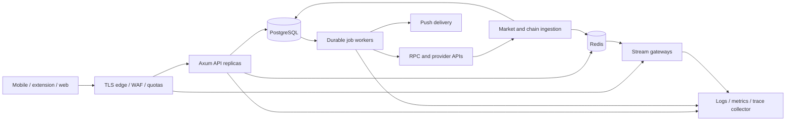
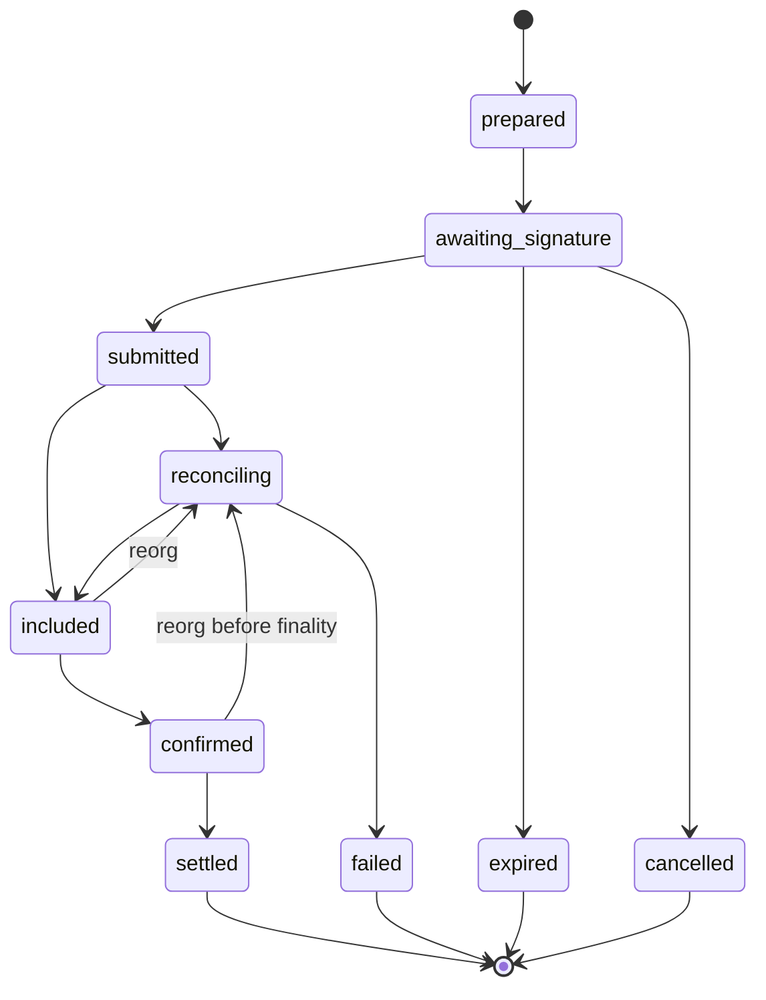

# Honey backend: architecture and delivery plan

Across direct quote reads now have authenticated API/client integration, explicit
operator asset IDs and exact Swap API attribution checks. A local-fork-only
source-to-delivery lifecycle is now wired through review/sign, journaled dispatch
and proof-gated settlement; public-network execution, provider acceptance and
refund verification remain open. See [ACROSS-QUOTES.md](ACROSS-QUOTES.md), D87–D88.

Status: design for review; P0/P1 plus distributed Redis pairing, public price
streams, initial native/extension sign-in, private metrics and sampled OTLP traces
are implemented. See
[IMPLEMENTATION.md](IMPLEMENTATION.md) and
[IDENTITY-AND-DURABILITY.md](IDENTITY-AND-DURABILITY.md) for shipped scope and limits.
Public stream evidence: [REDIS-AND-PRICES.md](REDIS-AND-PRICES.md),
[CAPACITY-LOCAL.md](CAPACITY-LOCAL.md). The local 10k-socket experiment does not
establish production mixed-workload capacity.
Aave V3/Morpho Vault V2 public data readers and cached API/web/native delivery are
implemented; see [EARN-READERS.md](EARN-READERS.md) and [EARN-CATALOG.md](EARN-CATALOG.md).
Immutable preparation persistence and authenticated operation recovery are implemented;
see [PREPARATION-AND-RECOVERY.md](PREPARATION-AND-RECOVERY.md). Aave preparation and independent
EIP-1559 signature validation now have a successful local-fork supply/withdraw proof;
see [AAVE-EXECUTION.md](AAVE-EXECUTION.md). Encrypted signed-bundle persistence, nonce coordination and an initial dispatch journal
are implemented ([SIGNED-SUBMISSIONS.md](SIGNED-SUBMISSIONS.md)). Receipt reconciliation,
finality gating and sequential dispatch now have a database-backed actual-contract fork
proof ([RECEIPT-RECONCILIATION.md](RECEIPT-RECONCILIATION.md)). Typed authenticated Aave APIs,
immutable signing terms, supervised execution/reconciliation and a native review/sign/status
flow are implemented for an explicitly configured local fork ([AAVE-API.md](AAVE-API.md)).
Owner-scoped history and unsigned-intent reopening now provide restart discovery
([OPERATION-HISTORY.md](OPERATION-HISTORY.md)). Production Aave activation and other
provider execution paths remain unfinished. Implementation-address/code checks and shared
RPC account admission are now wired into the Aave service
([RPC-AND-CONTRACT-IDENTITY.md](RPC-AND-CONTRACT-IDENTITY.md)); production registry
approval, provider entitlements and capacity proof remain open. The baseline observations below describe the code at the start of research.
Morpho Vault V2 deposit and exact-share redemption now have actual-contract
local-fork HTTP/worker acceptance, restart recovery and independent keyring/client
review checks. Native quote/review/sign/recovery is wired into Savings; physical-device
UX and production activation are unverified. Shared Earn engine design and evidence:
[MORPHO-EXECUTION.md](MORPHO-EXECUTION.md), decisions D59–D62.
Uniswap authenticated quote transport/validation and web/native quote forms are implemented
([UNISWAP-QUOTES.md](UNISWAP-QUOTES.md), D63–D65). Trading API acceptance still needs
credentials; tests use synthetic responses. Independent router decoders and Permit2
signature proof are implemented as pure building blocks ([UNISWAP-AUTHORITY.md](UNISWAP-AUTHORITY.md), D66–D67).
Ordered economic verification now covers token spending, minimum receive, fees and refunds
([UNISWAP-ECONOMICS.md](UNISWAP-ECONOMICS.md), D68–D69). Seven actual-contract local-fork
routes now pass, including V2/V3/V4 splits and fees ([UNISWAP-CONTRACT-ACCEPTANCE.md](UNISWAP-CONTRACT-ACCEPTANCE.md), D70).
Encrypted immutable built-swap preparations now integrate with owner recovery, signed submission
and reconciliation ([SEALED-SWAP-PREPARATIONS.md](SEALED-SWAP-PREPARATIONS.md), D71–D72).
Pre-build immutable review, encrypted permit admission and scoped nonce reservations are now
implemented as internal repository infrastructure ([SWAP-PERMIT-LIFECYCLE.md](SWAP-PERMIT-LIFECYCLE.md), D73–D74).
Validated quote artifacts, fixed-origin build transport and independently checked build responses are
implemented ([UNISWAP-BUILDS.md](UNISWAP-BUILDS.md), D75–D76). Authenticated provider acceptance remains open.
The internal Ethereum chain-observation and local sequence preparer now has mock coverage
([UNISWAP-PREPARATION.md](UNISWAP-PREPARATION.md), D77–D78). Reviewed build-to-preparation
persistence and authenticated recovery linkage now have mock-RPC/PostgreSQL coverage (D79).
The local swap HTTP/worker/native signing path is now connected through signed-bundle
admission with synthetic-provider/mock-RPC evidence ([UNISWAP-SERVICE.md](UNISWAP-SERVICE.md), D80–D81).
Actual-contract V3 service preparation/dispatch/finality now pass with restart, fees,
lost-acknowledgement and unfillable-minimum checks ([acceptance](UNISWAP-SERVICE-ACCEPTANCE.md), D82).
Production acceptance and additional service route/fault scenarios remain unverified.
Relay/Across advisory status readers, durable polling and owner-scoped web/native
history are implemented with synthetic-provider evidence
([BRIDGE-RECOVERY.md](BRIDGE-RECOVERY.md), D83–D84). They neither execute deposits
nor verify settlement; no public bridge command can register a watch yet.
Across direct-call validation and independent source/destination payment proof have
actual Ethereum/Base two-fork acceptance ([ACROSS-EVIDENCE.md](ACROSS-EVIDENCE.md),
D85–D86). A separate local 31337→31338 fixture mode now binds exact cached quotes,
prepares and simulates user-signed source transactions, dispatches them through the
durable journal, and marks an operation successful only after immutable finalized
source and destination proofs are committed. Its isolated config, short quote window,
fixture status transport, missing refund handling and absent live-provider acceptance
keep it out of production.
Production Uniswap activation, Relay/Across/Hyperliquid/Polymarket
execution, persistent-device authentication and production mixed-load capacity
verification are also unfinished. The backend is not ready for production launch.
Research date: 2026-10-17. Baseline commit: `297e0db` plus existing uncommitted work.
Owner: Honey engineering. Deployment, commercial agreements, fee policy, jurisdiction
and launch-chain decisions remain open. Nothing in this document proves production
capacity or authorizes moving funds, provisioning paid services, or deploying contracts.

## 1. Read this first

The target is **10,000 simultaneously connected users**, including live prices,
portfolio reads and some trading. That is not a definition of request rate. This
document specifies a proposed workload to test, names the bottlenecks, and records
what must be measured before claiming support.

Keep Rust/axum. Build a modular monolith with an API process, workers, and a separate
stream gateway deployment from shared code. Use PostgreSQL as the durable system
of record, Redis for disposable coordination/cache, and PostgreSQL jobs plus a
transactional outbox for reliable background work. Users sign on their devices.
Honey does not hold wallet seed phrases, private keys, or trading-agent keys.

Do not launch all integrations at once. Establish identity and operation tracking,
ship verified read models, then enable one bounded execution path per provider.
Every provider has independent read, quote, submit, cancel and withdraw switches.
Disabling new trades must not automatically disable safe cancellation or exits.

Words used throughout:

- **Observed:** inspected code or linked primary documentation.
- **Decision:** an engineering choice made here, with alternatives in
  [DECISIONS.md](DECISIONS.md).
- **Proposed target:** a number for testing, not a measured property.
- **Open:** evidence or a product/operational decision is missing.
- **Implemented:** only work listed as verified in [IMPLEMENTATION.md](IMPLEMENTATION.md).

## 2. Initial inspected baseline: evidence and consequences

The table records the repository state observed before this roadmap was
implemented. It is historical context, not a description of current behavior;
current implementation status and evidence are tracked in
[IMPLEMENTATION.md](IMPLEMENTATION.md) and [DEPLOYMENT-READINESS.md](DEPLOYMENT-READINESS.md).

| Surface | Observed evidence | Consequence |
| --- | --- | --- |
| HTTP runtime | `apps/server/src/lib.rs:39`: CORS, timeout, trace and request IDs | Useful starting point, no global admission budget or dependency lifecycle |
| Accounts | `apps/server/src/routes/accounts.rs:32`: registration and reads return 501 | No durable user/account ownership or portfolio service yet |
| Signing/relay | `apps/server/src/routes/relay.rs:22`, `session_signatures.rs:13`: 501 | Existing request types are not execution support |
| Pairing | `apps/server/src/routes/pairing.rs:82`: process-local mutex/map; `:99` prunes on access | Replica-local, restart loses mail; O(N) scans under one lock |
| Chain capabilities | `apps/server/src/chains/mod.rs:95`: static specification table | Not an allowlist of deployed, verified features |
| Client transport | `packages/api-client/src/client.ts:33`: health/version/pairing fetch wrapper | Shared integration seam; no application auth/session lifecycle |
| Main web app | `apps/web/src/App.tsx:11`: version connection status | This is not the full mobile wallet frontend |
| Mobile wallet data | `apps/mobile/src/lib/mock-wallet.ts:1` | Needs chain-specific read models, token IDs and freshness |
| Perps | `apps/mobile/src/lib/perps.ts:173`, `:273`: approximate liquidation, in-memory demo positions | Cannot reuse these calculations or mutations for live trading |
| Predictions | `apps/mobile/src/lib/predict.ts:175`: fixed trading cash | Must use actual provider buying power and outcome IDs |
| Swap flow | `apps/mobile/src/components/trade/SwapReview.tsx:81`, `:281`: local proposal/timed progress | Time passing is not evidence of signing, inclusion or settlement |
| Receipts | `apps/mobile/src/lib/tx-receipt.ts:16`: generated demo hashes | Live receipts must originate from verified submission/indexing |
| Profile | `apps/mobile/src/lib/profile.ts:7`: memory only | Authentication, account lifecycle and sync must be implemented |
| Jars | `apps/mobile/src/lib/jars.ts:4`: local accounting | Decide whether a jar earmarks funds or owns a separate on-chain position |
| Shared wallets | `apps/mobile/src/lib/multisig.ts:532`: local votes/execution | Chain contract state must govern authority and execution |
| Custody | `apps/server/src/lib.rs:6`: client-held signing material | Preserve this boundary across every provider |

Existing uncommitted extension/mobile/keyring work is outside this backend slice.
Do not overwrite it. The older source comments cite a numbered wallet spec, but
no corresponding complete spec was found in the inspected Markdown files. Treat
post-quantum, rotation, recovery and smart-account claims as unverified until the
actual deployed contracts, audit results and specification are provided.

## 3. Product coverage and proposed API boundaries

All routes below are **planned** unless IMPLEMENTATION.md explicitly lists them.
Authorization applies server-side even when the UI hides an action.

| Existing experience | Backend responsibility | Initial API boundary | Authority |
| --- | --- | --- | --- |
| Onboarding/sign in | challenges, sessions, devices, consent | `/auth/challenges`, `/auth/verify`, `/auth/refresh`, `/auth/logout` | Signed challenge, then session |
| Profile/settings | profile, locale, preferences, notification settings | `/me`, `/me/preferences` | User |
| Wallet switcher | ownership proofs and user-specific labels | `/me/wallets` | User + proof; watch-only is separate |
| Home/portfolio | balances, valuations, history, partial-chain failures | `/wallets/{id}/portfolio` | Wallet membership |
| Token/search/charts | canonical token metadata, bounded search, candles | `/assets`, `/assets/{id}`, `/markets/candles` | Public with quota |
| Activity/receipt | operations, steps, transfers and finality | `/operations`, `/operations/{id}` | Owner or shared-wallet member |
| Send/receive | recipient validation, simulation, gas, relay/status | `/transfers/prepare`, `/operations/{id}/submit` | Ownership + signed payload |
| Swap/bridge | compare executable routes, fees, steps, refunds | `/swap/quotes`, `/swap/prepare` | Session + wallet ownership |
| Earn/savings | approved vaults/reserves, APY, liquidity, positions | `/earn/products`, `/earn/positions`, `/earn/prepare` | Public products, private positions |
| Jars | allocation labels, goal and movements | `/jars`, `/jars/{id}/movements` | User; never invent balances |
| Perps | markets, account/margin, orders, fills, cancel/close | `/perps/markets`, `/perps/account`, `/perps/orders` | Provider-compatible signer |
| Predictions | markets/outcomes, books, eligibility, orders, redemption | `/prediction/markets`, `/prediction/orders`, `/prediction/positions` | Eligible user + valid signer |
| Shared wallets | deployment, membership, proposals, verified signatures | `/shared-wallets`, `/proposals` | On-chain threshold/nonce |
| Recovery/security | exposure events, guardians, migration monitoring | `/accounts/{id}/recovery`, existing exposure routes | Proof + verified chain state |
| Pairing | ephemeral encrypted mailbox, abuse limits | Existing `/pairing/{channel}/{slot}` | Pair token, not login session |
| Cloud backup | encrypted blob metadata only if backend is needed | Separate future backup contract | Client encryption; no phrase upload |
| Collectibles | collection/item metadata, ownership, spam filtering | `/wallets/{id}/collectibles` | Ownership read, metadata untrusted |
| Handles/contacts | name resolution, contacts, abuse controls | `/handles/{handle}`, `/me/contacts` | Public resolution/private contacts |
| Push/in-app notifications | preferences, delivery attempts, deduplication | `/me/devices`, `/notifications` | User/device |
| Buy/sell cash | licensed on/off-ramp session and webhook state | `/ramps/sessions`, provider webhook | Provider agreement, eligibility |
| Support/data deletion | export, deletion, scoped support investigation | `/me/export`, `/me/deletion` | Reauthentication + audit |

Do not conflate an app user, a wallet address, a smart account, a provider trading
account, and a device. Each has its own identifier, permissions and lifecycle.
Email access does not prove wallet ownership; Face ID does not authenticate an API
request; watch-only access never permits signing or provider account attachment.

## 4. Workload and capacity model

### 4.1 Proposed acceptance workload

There is no production traffic trace in this repository. Use these explicit test
inputs until product analytics replace them:

| Workload | Normal test | Burst/failure test |
| --- | --- | --- |
| Connected clients | 10,000 TLS WebSockets | 15,000 attempted; excess rejected cleanly |
| Read requests | 2,000 requests/sec | 5,000 requests/sec for 60 seconds |
| Quote requests | 100/sec total across providers | 300/sec; quotas shed excess |
| Operation submissions | 20/sec | 100/sec with duplicate retries |
| Private updates | 2,000 active trading accounts | Provider limits must support this separately |
| Subscribed instruments | Mean 20/client | Max 100/client, popular-symbol skew |
| Price publish cadence | Coalesced at 1 Hz initially | Selected detail view at up to 4 Hz |
| Churn | 1% connections/minute | 10,000 reconnect attempts over 30 seconds |
| Duration | 60-minute steady run | 6-hour soak plus failure injection |

These counts are intentionally independent: 10,000 people do not imply 10,000
concurrent database queries, nor do they imply every person trades once a second.
Public API contracts and provider accounts must be negotiated against the quote
and private-stream workload, not just the number of registered users.

### 4.2 Resource arithmetic to validate

- At 2,000 RPS and 200 ms mean service time, Little's law gives roughly 400 active
  HTTP requests across the service. A 256-request cap per API replica is a starting
  guardrail, not a sizing claim. Requests waiting on providers consume that budget.
- 10,000 clients × 20 prices × 100 encoded bytes × 1 Hz is 20 MB/s payload before
  TLS, WebSocket framing, envelopes and retransmission: about 160 Mbit/s. At 4 Hz
  it becomes 80 MB/s. Batch updates and measure actual encoded bytes and CPU.
- A 64 KiB per-connection pending-output budget alone consumes about 625 MiB at
  10,000 sockets. Kernel buffers, TLS, tasks and subscription indexes add more.
  Track process RSS against load; do not budget memory from payload size alone.
- Proposed starting topology: 4 API replicas, 4 stream replicas, 2 workers, across
  at least 2 failure domains. With one of four gateways down, each survivor must
  support about 3,334 sockets, not its normal 2,500. Hardware is selected by tests.
- Example DB budget: 4 APIs × 20 + 2 workers × 10 + 20 operational reserve = 120
  connections. Set the database limit with migration, monitoring and failover
  reserve. Replica autoscaling must respect the *total* pool budget.
- Polling 10,000 portfolios every 5 seconds produces 2,000 requests/sec before
  quotes. Prefer invalidation plus a bounded fallback interval, not screen-local
  polling from each of Home, Portfolio and the wallet switcher.

### 4.3 Proposed service objectives

| Operation | Initial target | Measurement |
| --- | --- | --- |
| Cached market read | p95 < 150 ms, p99 < 400 ms | Edge-to-API response; warm/cold split |
| Portfolio read | p95 < 500 ms | Includes partial-state response; upstream age separate |
| Quote | p95 < 2 seconds | Provider breakdown, timeout and unavailable rates |
| Submission acceptance | p95 < 500 ms | Durable acceptance, not settlement |
| Public price freshness | p95 < 2 seconds after provider timestamp | Clock skew tracked |
| Private status propagation | p95 < 2 seconds after observation | Chain finality reported separately |
| API availability | Proposed 99.9% monthly | Explicit eligible-request denominator |
| Data safety | No acknowledged operation lost | Crash/restart and backup-restore tests |

Expected client validation failures are not server errors. Capacity rejections
count against the user-facing availability budget; do not hide overload by
excluding all 429/503 responses. Report provider outages separately and as part
of the end-to-end feature SLO.

## 5. Runtime topology and module ownership



Proposed Rust modules:

| Module | Owns | Must not own |
| --- | --- | --- |
| `identity` | principals, sessions, proof verification | Transaction-signing keys |
| `wallets` | membership, account links, chain identity | Symbol-based token matching |
| `portfolio` | materialized balances, valuations, snapshots | Invented or zero-filled failed reads |
| `operations` | intent, steps, idempotency, transitions | Provider-specific wire DTOs |
| `integrations` | provider adapters and normalization | User policy or fee decisions |
| `fees` | approved fee policies and reconciliation | Mutating signed fee parameters |
| `market_data` | canonical instruments, snapshots, freshness | Trade authorization |
| `streaming` | subscriptions, coalescing, resync | Durable operation truth |
| `jobs` | leases, retries, outbox delivery | Business decisions hidden in retry code |
| `notifications` | durable notification and delivery state | Secrets or full balances in lock-screen text |
| `platform` | config, pools, telemetry, readiness, shutdown | Product business logic |

Handlers validate/extract context and invoke application services. Services own
transactions and invariants. Repositories contain SQL. Adapters translate provider
responses to domain types. Avoid a universal generic repository and inheritance
hierarchy. Use small traits where there are multiple providers or a useful test
boundary; concrete types elsewhere. Provider DTOs never become public API DTOs
without validation and normalization.

A gateway deployment split is justified by long-lived connections and bandwidth;
it is not a mandate for seven provider microservices. Extract a service only when
independent scaling, ownership or fault isolation is measured to require it.

## 6. Data model and persistence

### 6.1 Identity and money representations

- Internal entity IDs: UUIDs. External chain/provider IDs retained separately.
- Chain IDs: explicit namespace/reference (CAIP-style), e.g. `eip155:8453`, not
  the existing broad `evm` enum. Solana cluster/genesis identity and Bitcoin
  network must be explicit. Do not globally lowercase non-EVM addresses.
- Asset key: chain identity + asset namespace + canonical contract/mint/reference.
  Native assets are explicit. `USDC` on two chains is never the same database key.
- Amounts: unsigned integer base units as decimal strings at JSON boundaries;
  checked integer/decimal arithmetic internally. PostgreSQL `numeric(78,0)` plus
  nonnegative and protocol-range constraints for uint256 amounts. Precision 78
  alone does not enforce the uint256 maximum. No `f64`/JS `number` for execution.
- Prices, rates and ratios: decimal strings with documented scale and rounding.
  Persist original base/share amounts; round only for display or provider-required
  tick/lot sizes. Quote all-in amounts conservatively in the user's favor.
- Wall-clock timestamps: UTC RFC3339. Ordering: database version/sequence, not
  phone clock. Durations/deadlines inside a process use a monotonic clock.

### 6.2 Proposed tables, keys and indexes

| Table | Important fields | Constraints/indexes |
| --- | --- | --- |
| `users` | id, status, created/deleted timestamps | No wallet-address-as-user-ID |
| `profiles` | user_id, display name, avatar reference, version | user PK, optimistic version |
| `auth_challenges` | digest, domain, audience, chain, expiry, consumed_at | unique digest; atomic consume |
| `sessions` | token digest, user, device, expiry, revocation, family | unique token digest; user/device index |
| `wallets` | chain_id, canonical address, account kind | unique chain/address |
| `wallet_memberships` | user, wallet, role, proof metadata | unique user/wallet; role not client supplied |
| `provider_accounts` | wallet, provider, external account, signer/funder type | unique provider/external identity |
| `devices` | user, push token ciphertext, platform, last_seen, revoked_at | unique active token digest |
| `assets` | canonical ID, decimals, metadata version, spam state | unique chain/reference |
| `balance_snapshots` | wallet, asset, raw balance, block number/hash, observed_at | wallet/asset unique current row |
| `chain_cursors` | chain, stream, block/hash, safe/finalized positions | chain/stream unique |
| `chain_events` | chain, tx, log/instruction index, block/hash, canonical flag | natural dedupe + reorg identity |
| `operations` | user, wallet, kind, state, version, quote, intent hash | user/created_at/id for keyset paging |
| `operation_steps` | operation, ordinal, provider, action, state, external ref | operation/ordinal unique |
| `operation_events` | operation, version, old/new state, evidence, reason | operation/version unique |
| `idempotency_keys` | principal, route, key digest, request digest, operation | unique principal/route/key |
| `quotes` | owner, input digest, provider, expiry, normalized fees, policy version | owner/expiry; no public caching |
| `signed_payloads` | operation/step, digest, encrypted payload, expiry | digest unique in its chain/signer scope |
| `jobs` | type, reference, run_at, attempts, lease owner/token/until, state | partial runnable index; dedupe key |
| `outbox` | aggregate/version, event type, publish state, run_at | aggregate/version/type unique |
| `inbox` | provider, event ID/digest, observed_at | provider/event unique |
| `fee_policies` | provider, chain, revision, effective window, recipient/rate | immutable revisions |
| `fee_entries` | execution/fill ID, asset, amount, state, policy revision | source + component unique |
| `fee_payouts` | provider, payout reference, amount/asset, reconciliation | unique external payout |
| `earn_products` | protocol/version, chain/address, asset, risk review | chain/address/version unique |
| `positions` | provider, account, product, raw shares/size, snapshot version | provider/account/product unique |
| `notifications` | user, event ID, kind, read_at | user/event/kind unique |
| `notification_attempts` | notification, device, channel, attempt, result | notification/device/attempt unique |
| `jars` | owner, goal amount/asset, allocation policy | user/id; optimistic version |
| `proposals` | wallet, contract nonce, action digest, status | wallet/nonce/digest identity |
| `proposal_signatures` | proposal, signer, signature, verified_at_block | proposal/signer unique |
| `audit_events` | actor, action, entity, reason, request/trace reference | append-only role; bounded retention |

This is a schema design, not a migration already applied to a real database.
Create migrations with each vertical slice, constraints before enabling writes,
and query-plan fixtures at realistic cardinalities. Avoid a giant unused initial
schema. CI creates an isolated database; deployments run an explicit migration
job, not one migrator in every API replica.

### 6.3 Transaction and consistency rules

Use read committed plus unique constraints and row locks for short transactions.
Use compare-and-swap versions for state transitions. Retry serialization failures
only for side-effect-free transaction blocks. Never hold a SQL transaction while
calling a provider, waiting for a signature or sleeping.

The authoritative ledger of money remains the chain/provider. Honey stores
observations and workflow state. A cached balance is not a reservation enforceable
against another wallet client. Recheck simulation/allowance/balance at preparation,
and expose possible failure rather than pretending Honey can prevent external spends.

Keep block hash and finality alongside chain observations. Reorg handling retracts
or supersedes observations and recalculates affected projections. An operation
may move from included to reconciling/reorged, even after a prior UI confirmation.
Keep that history; never overwrite evidence to make the timeline look linear.

### 6.4 Pooling, backup and retention

Bound pool acquisition and SQL statement timeouts separately. Measure pool waits,
active/idle connections, slow normalized queries, lock waits and replica lag.
Use prepared parameterized queries. Private post-write reads go to the primary;
read replicas are only for endpoints that advertise tolerated lag.

Use managed multi-zone PostgreSQL if the selected host supports it. Proposed RPO
is at most 5 minutes and RTO at most 60 minutes; these remain unproven until a
timed restore exercise. Encrypt backups, restrict restore access, and test PITR.
An application acknowledgement requires a committed operation and its outbox row.
The real RPO depends on replication/backup guarantees, not application code.

Retention proposal: ephemeral quotes/signed-payload ciphertext expire promptly;
operational logs 14 days; searchable audit/fee records follow a separately approved
retention policy. Do not invent statutory retention periods. Deletion removes
profile/device/contact data and severs unnecessary links; public chain history
cannot be erased. Document backups and any mandatory retained records to users.

## 7. Identity, authorization and custody

### 7.1 Authentication sequence

1. Issue a random, short-lived, single-use challenge bound to domain, audience,
   chain, intended address, action and nonce. Rate-limit issuance and verification.
2. The client verifies the displayed domain and signs locally. Use the correct
   chain/account verifier; EVM EOA recovery is not a smart-account verifier.
3. Verify signature and chain/account state, then atomically consume the nonce and
   create the session. Concurrent replays must yield one successful consume.
4. Return a short-lived access credential and a rotating refresh credential.
   Proposed lifetimes: 15 minutes / 30 days, subject to product review. Store
   refresh digests, detect reuse, revoke the whole refresh family on replay.
5. Native/extension credentials use platform secure storage. Web uses HttpOnly,
   Secure cookies with a deliberate SameSite/CSRF policy; CORS is not CSRF defense.
6. Every private query scopes by principal and authorized membership. Every private
   stream topic repeats the authorization check and reacts to revocation.

Initial choice: opaque sessions backed by PostgreSQL, with bounded Redis lookup
cache once revocation behavior is tested. This avoids making a JWT signing/key
rotation system a prerequisite, at the cost of lookup traffic. Cache outage must
not resurrect a revoked session. Email/OTP and social login are a separate identity
linking feature with a provider still to be chosen; never treat them as spending
authority or wallet recovery.

### 7.2 Signer compatibility is a launch gate

The current wallet model includes unusual rotating keys and non-execution session
anchors. Provider integrations must prove their supported signature type against
the actual account implementation. An EIP-1271-compatible account does not imply
all venues support that account for every action. Hyperliquid master-wallet builder
approvals and Polymarket signer/funder relationships require specific tests.

Maintain a matrix by provider, chain, account version and action: quote, approve,
sign, submit, cancel, withdraw, recover. Unsupported combinations remain disabled.
No invisible conversion from a watch-only wallet or smart account into an EOA.
If an integration needs an API/agent signing key, keep it on the client under
explicit scope and expiry; a server-held signer requires a separate custody decision.

### 7.3 Abuse and security boundaries

Use edge IP limits plus authenticated per-user and per-operation quotas. Normalize
IPv4-mapped IPv6 and group IPv6 appropriately, preserving the existing pairing
proxy-hardening behavior. Trust forwarded IPs only on a restricted ingress path.
Set body, header, query, signature, page-size, batch-size and subscription limits.

Never accept user-provided upstream URLs. Provider base URLs and chain RPCs come
from reviewed configuration; reject redirects to unapproved origins. Bound response
bytes and decode depth. Treat NFT metadata, symbols, market titles, avatars and
provider error strings as untrusted content. Do not render arbitrary HTML or proxy
arbitrary metadata URLs into private infrastructure.

Use explicit field validation, not just permissive deserialization. Sensitive
submit endpoints reject unknown fields and unsupported transaction types. Check
chain, signer, recipient, spender, amount bounds, slippage, deadline, value,
contract/selector and fee policy before a payload is offered for signature and
again before relaying it. Never log request bodies, cookies, bearer tokens,
pair tokens, signatures, calldata or complete provider responses by default.

## 8. Redis, caching and rate limits

### 8.1 Separate ephemeral domains

Redis is not the authority for acknowledged operations, fees or jobs. Use separate
instances or resource-isolated deployments for cache and correctness-sensitive
ephemeral coordination. Cache may use an eviction policy. Pairing/nonces/quotas
must not silently lose tombstones because a price cache fills the same memory.

| Data | Starting policy | Failure behavior |
| --- | --- | --- |
| Token metadata | 1 hour fresh, versioned refresh | Serve labeled stale metadata |
| Public prices | 1 second fresh; stale threshold per instrument | Emit stale flag; block price-sensitive prepare |
| Chart candles | Closed candles long-lived; active candle short TTL | Return last complete series with age |
| Earn catalog/APY | 30–60 seconds for display | Stale display allowed; no stale execution checks |
| Portfolio display | 5–15 seconds per wallet/chain/block | Partial states; failed chain is unknown, not zero |
| Execution quote | Never shared; obey provider no-cache policy | Requote; no stale execution fallback |
| Auth lookup | Short bounded TTL tied to revocation mechanism | Query DB or fail closed |
| Pairing | 5-minute channel lifetime; write-once tombstones | Fail closed; restart pairing if storage lost |
| Quotas | Atomic token bucket with bounded key TTL | Local conservative fallback for public reads; fail closed for expensive mutations |

All TTLs are Honey starting decisions, not provider guarantees. Keys include
environment, schema revision, chain and canonical identity; private keys include
principal or wallet scope as appropriate. Avoid caching auth-bearing responses at
the CDN. Sensitive responses use `Cache-Control: no-store`.

### 8.2 Algorithms and stampede control

Use process-local singleflight for identical public reads; distributed refresh
ownership only if measurements justify it. Add randomized expiry jitter and short
negative caching for genuinely missing public resources. Never negative-cache an
upstream timeout as a nonexistent asset. A refresh lease needs a unique token and
compare-and-delete release so an old owner cannot delete a new owner's lease.

Rate limiting uses atomic token buckets with server-side time, fixed capacity,
bounded key counts and expiry. Provider limits may be weighted, endpoint-specific,
per key, per IP and per address simultaneously; all applicable budgets must pass.
Retries spend quota too. Do not use rotating proxies/API keys to evade a provider's
limits. Fairness separates background backfills, browsing, quotes and cancel/exit.

### 8.3 Pairing migration

Replace the mutex/map with Redis atomic scripts only in a dedicated follow-up.
Preserve authorization, lowercase channel normalization, IP bucketing, TTL,
per-client limits, global capacity and read-once/write-once behavior. Anchor all
four slots to one channel expiration. A read consumes the payload but preserves a
tombstone until expiration. Failed reads must not extend life.

Cross-replica tests must prove: concurrent PUT has one winner; concurrent GET has
one delivery; TTL does not revive a consumed slot; quota cannot be bypassed with
forged forwarded headers; one hot channel cannot hold a global lock; Redis failure
does not fall back to a second, independent mailbox. Existing local pairing remains
single-replica until this migration is complete. Session affinity is only a temporary
deployment restriction, not a durability solution.

## 9. Durable jobs, outbox and reconciliation

### 9.1 Queue design

Start with PostgreSQL jobs because operation + job creation can commit atomically.
Workers claim a small ordered batch with `FOR UPDATE SKIP LOCKED`, mark lease owner,
random fencing token and deadline, then commit before doing network I/O. PostgreSQL
explicitly describes SKIP LOCKED as suitable for queue-like consumers, not general
consistent reads. [PostgreSQL SELECT](https://www.postgresql.org/docs/current/sql-select.html)

Proposed job classes: chain receipt reconciliation; provider order/fill reconciliation;
bridge fill/refund tracking; portfolio refresh; notification delivery; fee reconciliation;
metadata refresh; backup/export/deletion work. Partition concurrency budgets by class
so a chart backfill cannot starve pending withdrawals.

Guarantee **at-least-once delivery**, not exactly-once external execution. Every
consumer has a natural dedupe key and transactional state update. Completion checks
the lease token; an expired worker cannot mark another worker's claim complete.
External fencing is not always possible, so submission dedupe must also use chain
transaction hash/provider client order ID, and ambiguous outcomes require querying
before retry. Lease heartbeats alone cannot prevent duplicate external requests.

Retry transient timeouts/429/5xx with capped exponential backoff and full jitter,
respect Retry-After, enforce attempt/age limits, and send exhausted work to a dead
letter state with an operator reason. Permanent invalid signatures, unsupported
chains, expiry and eligibility failures are not retried. Replaying dead letters
requires a recorded operator action and a fresh validity check.

Outbox rows share the operation transaction. A dispatcher publishes after commit;
duplicate publication is possible, so recipients use event IDs/version checks.
Redis Pub/Sub is only a wakeup/live-delivery mechanism. Reconnect recovery reads
durable state/events rather than assuming a live subscription delivered everything.

### 9.2 Crash points to test

| Crash point | Required recovery |
| --- | --- |
| Before DB commit | No acknowledgement; retry with same idempotency key |
| After commit, before HTTP response | Same key returns the existing operation |
| After lease claim, before provider request | Lease expires; another worker resumes |
| After provider accepted, before result persisted | Query external ID/hash; never assume failure |
| After event publish, before outbox marked sent | Duplicate event safely ignored |
| After source bridge inclusion | Continue destination/refund monitoring independently |
| During fee import | Unique fill/component key prevents double counting |
| During DB failover | Reject uncertain writes until transaction outcome is known |

Introduce Redis Streams, SQS or Kafka only if queue lag/throughput, independent
consumers or retention justify another system. The outbox boundary makes later
replacement possible without a distributed transaction across DB and broker.

## 10. Operation lifecycle and transaction safety

### 10.1 Common lifecycle



This is an umbrella model. Bridge steps additionally include source included,
destination pending/filled, refund available/requested/refunded and manual review.
Orders have accepted/open/partially-filled/filled/cancel-pending/cancelled/rejected
states and separate fills. A cancellation can race a fill. Do not force every
provider into a single transaction state machine that discards useful evidence.

### 10.2 Preparation and submission

1. Validate identity, wallet ownership, capability, eligibility, input units and limits.
2. Fetch balances/allowances/risk at a known chain/provider snapshot.
3. Obtain routes under bounded provider fanout; normalize fees and minimum output.
4. Store immutable intent digest, provider quote reference, fee-policy revision,
   expiry, transaction steps, simulation evidence and intended signer.
5. Return a review payload with raw amounts, units, minimum receive, maximum spend,
   fee components, recipient, chain, approvals and deadlines. Client checks it too.
6. Client signs only after user confirmation. Multi-step operations require review
   when later steps materially change. Approval success is not swap success.
7. Submission binds the signed payload to the prepared intent and idempotency key.
   Persist operation + job before acknowledging accepted work.
8. Broadcast with a deterministic chain hash or supported client order ID. A network
   timeout is `reconciling`, not permission to create a new order or new nonce.
9. Follow inclusion, finality, fills and refunds; update portfolio from observations.

Idempotency scope is `(principal, route/action, key)`, with a digest over normalized
semantic input. Same key + different input returns 409. Same key + same intent
returns the same operation. Do not expire the record while an external side effect
can still materialize. Retention is action-specific, not one blanket 24-hour TTL.

### 10.3 Chain-specific edge cases

- EVM: replacement nonce, dropped/pending transaction, fee escalation consent,
  allowance reset tokens, Permit2 domain/nonce/expiry, native gas reserve, fee-on-
  transfer/rebasing tokens, malicious approvals, reorg and L2 sequencer failure.
- Solana: recent blockhash expiry, simulation slot, compute budget, priority fees,
  address lookup tables, token program differences and ATA creation costs. An
  expired blockhash requires a new user-reviewed signature, not modified bytes.
- Bitcoin: UTXO selection, change derivation, dust, fee rate, RBF/CPFP policy,
  conflicting spends and confirmation depth. Coin selection belongs to an audited
  wallet implementation, not a generic account-balance service.
- Tron: energy/bandwidth, activation costs, address encoding and receipt semantics.
- XRPL: destination tags, reserve requirements, sequence/tickets, last-ledger bounds
  and distinction between provisional and validated results.

These are required design/test cases, not claims that adapters already support them.
Launch each chain only after official chain documentation, signer support and
provider RPC behavior have been checked in that implementation phase.

## 11. Provider integrations and economics

### 11.1 Shared adapter contract

Adapters expose capabilities, market/account reads, quote/prepare, validation,
signed submission (where supported), status, cancel and fee evidence. Optional
methods return explicit unsupported errors; never silently downgrade a requested
guarantee. Provider errors map to a bounded Honey taxonomy, with the original
provider request ID retained in restricted diagnostic context.

Each outbound call has a connect deadline, total deadline, maximum response size,
concurrency permit, quota permit and circuit-breaker classification. Circuit
breakers count transient provider faults, not client input errors. Half-open probes
are limited. Retries occur at one layer only. Never multiply API retry × worker
retry × SDK retry into an uncontrolled request storm.

Version every adapter against a reviewed API/SDK schema and signed-payload fixture.
Provider docs are moving targets: the sources below are the state retrieved on
the research date, not immutable specifications. Archive schema hashes/fixture
versions when implementing. An example address in documentation is not a launch
allowlist. No live signed writes were performed during this research.

### 11.2 Uniswap: same-chain swaps first

Observed: the Trading API separates approval checking, quotes, AMM transaction
construction and UniswapX order submission. CLASSIC and auction orders have different
execution/status paths. [Integration guide](https://developers.uniswap.org/docs/trading/swapping-api/start-building/integration-guide)

Observed: the default API-key quota is 6 RPS; additional capacity requires contact.
The FAQ describes integrator fees and a 5% ceiling. This is a provider ceiling,
not a proposed Honey fee. [FAQ](https://developers.uniswap.org/docs/trading/swapping-api/faqs)

Honey decision: first ship exact-input CLASSIC swaps for reviewed EVM assets and
contracts. Preserve the adapter distinction for UniswapX, but enable it only after
order expiry/cancel/fill and wallet-signature compatibility tests. Review Permit2
spender, domain, nonce, allowance amount and expiration on both client and server.
Never display gross output as net output when fees are separate. The quote
reference documents fee fields and amount semantics; test them with fixtures.
[Quote reference](https://developers.uniswap.org/docs/api-reference/aggregator_quote)

Acceptance: approval already sufficient; zero-reset approval; expired quote; no
route; wrong chain; unsupported token behavior; gas insufficiency; simulation
failure; partial provider outage; provider fee added exactly once; replacement
transaction; identical signed payload resubmitted after response loss.

Open: production key, quota agreement, approved routers/versions, supported chains,
fee recipient/rate and whether UniswapX is part of the first release.

### 11.3 Relay: bridge/swap as a resumable sequence

Current implementation: fixed-origin v3 status reads, bounded normalization and
durable advisory observations only. Deposit execution and independent settlement
proof remain open. [Bridge recovery design](BRIDGE-RECOVERY.md) records current
contract research, explicit refund-address policy and the announced v3.2 migration.

Observed: Relay documents ordered transaction/signature steps and status checking.
Do not treat a quote as one generic EVM transaction.
[Step execution](https://docs.relay.link/references/api/api_core_concepts/step-execution)

Observed: published default quote quota is 50/minute per key; elevated quotas are
requested separately. Keys stay on the server. Confirm quota coverage for the
selected quote version in the actual account agreement.
[API keys and limits](https://docs.relay.link/references/api/api-keys)

Honey decision: persist provider request ID, each step, source/destination asset,
refund recipient and fill/refund state. Treat provider-returned polling or execution
URLs as data to validate against an allowlist, not arbitrary URLs to fetch. Never
replay completed deposit steps after reconnect. Independently verify destinations
and quote input semantics before signing.

Relay documents app fees and fee collection mechanisms. Model a quoted fee, accrued
fee and claimable/paid fee separately. A referral label is not proof of receipt.
[App fees](https://docs.relay.link/features/app-fees)

Acceptance: already-completed step; delayed source index; destination shortage;
refund on supported route; wrong recipient; unsupported account; stale step;
duplicate webhook/status observation; provider incident after source inclusion.

### 11.4 Across: independent bridge adapter

Current implementation: local-fork-only direct ERC20 quotes, immutable intent,
source-chain approval/deposit simulation, client-signed transaction envelopes,
journaled dispatch, origin-chain/deposit-ID status reads, exact source transaction
binding and independently verified destination fill/refund evidence. Expiry never
means funds returned. Actual-contract fork evidence and source-proof watch attachment
are documented in [ACROSS-EVIDENCE.md](ACROSS-EVIDENCE.md); durable outcome handling
is documented in [BRIDGE-RECOVERY.md](BRIDGE-RECOVERY.md). The provider adapter is
explicitly local-only and does not constitute production route, credential, or
capacity acceptance. The 30-second quote-cache TTL is kept separate from the
simulation-derived signing-plan window (at most five minutes, capped by provider
expiry, user deadline, and on-chain terms). Each unsent dispatch step re-simulates
the remaining exact calls and checks the stored nonce and signed gas/fee ceilings;
any drift fails closed. Unit, HTTP/idempotency, settlement and quote integration
tests cover these boundaries. The full worker/signature path still needs an
end-to-end local JSON-RPC fixture and production-route acceptance.

Observed: current docs use `/swap/approval`, production API credentials/integrator
identity, approval transactions, a main swap transaction and expiry. `appFee` is
a decimal fraction, not basis points; recipient is on the destination chain.
The docs prohibit caching executable quote responses.
[Swap API](https://docs.across.to/introduction/swap-api)

Honey decision: normalize Across separately from Relay; preserve its route IDs,
expiry, refund address and origin/destination evidence. Do not convert a failed
exact-output requirement into exact-input silently. Show any route-specific fill
timing and refund conditions in the review. No shared quote cache or automatic
retry that risks making two deposits.

Acceptance: asset route unsupported; insufficient bridge liquidity; quote expires
after approval; source succeeds/destination pending; refund observed; fee fraction
conversion checked; wrong destination fee address; approval list validation.

Open: Across credentials, quotas, supported routes and integrator ID. The current
reference and overview differ in how they label some required parameters; pin the
production OpenAPI schema and verify authenticated fixtures before launch.
[API reference](https://docs.across.to/api-reference)

### 11.5 Route comparison

Use bounded concurrent fanout only to eligible providers. Rank by conservative net
receive after all fees and gas, then explicit user preferences such as speed and
route risk. Do not route by Honey revenue. Different guarantee types cannot be
compared as if identical: exact-input, exact-output, minimum-output, asynchronous
bridge and auction order require distinct presentation.

For a fixed small provider set, comparison is O(P); building a proprietary graph
router or Dijkstra search is unnecessary while providers supply routes. If a
provider times out, return partial alternatives with evidence of which candidates
were compared. Persist the chosen quote, not merely a provider name and estimated
USD value. Rapid keypad input is debounced; cancel obsolete *reads*, not submitted
operations. Maximum fanout and quote quota protect provider costs.

### 11.6 Morpho: curated Earn products

Observed: Morpho Vault V2 exposes ERC-4626 assets/share methods, with distinct
preview/conversion operations. Integration must consider rounding and vault
protection/configuration; do not infer shares from displayed USD.
[Vault mechanics](https://docs.morpho.org/developers/earn/concepts/vault-mechanics/)

Observed: Morpho offers an API for indexed data. Honey uses indexed data for
discovery/display, then verifies execution-critical state via the selected chain
RPC and exact contract version. [API](https://docs.morpho.org/developers/api/get-started/)

Honey decision: an approved product registry records vault version, chain/address,
underlying asset, curator, risk review, caps/gates, fee model, liquidity and audit
references. Begin with VaultBundlesV1 deposits/redemptions to selected existing vaults;
no automatic highest-APY rebalancing or new wrapper deployment in this phase.
Expose base APY, incentives, fees, timestamp and liquidity separately. Validate
the actual feasible withdrawal path; simulation can go
stale. Never advertise a guaranteed yield or immediate redemption from an illiquid
position. Define minimum shares/output protection for the chosen transaction path.

Verified implementation correction (2026-10-18): Vault V2's four ERC-4626 `max*`
methods return zero unconditionally. They cannot establish whether a deposit or
redemption is executable. The implemented adapter checks pinned configuration and
simulates exact balance deltas. VaultBundlesV1 enforces deposit share-price limits;
its redemption function has no minimum-output argument. Honey supports exact-share
redemption with explicit acknowledgment of unprotected output, never a fabricated
minimum payout. See [MORPHO-EXECUTION.md](MORPHO-EXECUTION.md) for pinned sources.

Observed: distributor revenue can involve wrappers or curator agreements; vault
fees are not automatically Honey revenue. Defer monetization until a specific
agreement or reviewed wrapper is approved.
[Distributor revenue](https://docs.morpho.org/developers/earn/concepts/generate-revenue/)

Acceptance: tiny deposit/zero shares, decimal mismatch, cap reached, gated vault,
illiquidity, changed exchange rate, rewards excluded from base APY, risk suspension,
partial withdrawal, version-specific behavior, approval transaction succeeds but
deposit fails. Disabling deposits must preserve supported withdrawal/recovery paths.

### 11.7 Aave: supply and withdraw only initially

Observed: Aave V3 has supply/withdraw integration paths; available withdrawal is
constrained by liquidity and collateral/debt health. Native-asset handling uses a
gateway and differs from ERC-20 supply.
[Market operations](https://www.aave.com/docs/aave-v3/markets/operations),
[Withdrawals](https://aave.com/help/supplying/withdraw-tokens),
[Gateway](https://www.aave.com/docs/aave-v3/smart-contracts/wrapped-token-gateway)

Honey decision: explicitly select V3 deployments for the initial adapter and keep
protocol version in every product ID. Current docs also contain V4; do not mix
versions by copying the newest SDK example into a V3 flow. Start with selected
reserves, no borrow UI. Still inspect existing debt/collateral created by other
apps before withdrawals. Respect paused/frozen states, supply caps, available
liquidity and actual aToken balance. Verify state at a block and simulate.

A referral parameter is not an automatic fee entitlement. Use zero/unset where
documented until a real program is agreed. Adding a fee wrapper is a separate
contract and product decision, not a hidden charge in the direct Pool call.

Acceptance: outside-app borrowing affects withdrawable amount; reserve frozen;
pool illiquid; native wrap/unwrap costs; exact/max withdrawal rounding; wrong pool
version; aToken valuation includes accrued balance correctly; deposit failure
after approval. Savings UI must not call all returns fixed interest.

### 11.8 Hyperliquid: perps

Observed: builder approval requires the main wallet, not an agent wallet. Builder
fees are expressed in tenths of a basis point, capped by venue policy; the user
approves a maximum and can revoke it. Current docs also require builder account
funding. No funding action is authorized by this plan.
[Builder codes](https://hyperliquid.gitbook.io/hyperliquid-docs/trading/builder-codes)

Observed: published limits include 1,200 REST weight/minute per IP, 10 WebSockets,
1,000 subscriptions, and only 10 unique users in user-specific subscriptions per
IP. Consequently a single public-IP private-stream proxy cannot serve thousands
of trading accounts under those published limits.
[Limits](https://hyperliquid.gitbook.io/hyperliquid-docs/for-developers/api/rate-limits-and-user-limits)

Honey decision: share public market feeds. For private streams choose an approved
venue/indexing agreement or client-direct authenticated/subscribed delivery, with
server reconciliation within negotiated limits. Do not claim centralized 10k-user
private feeds work by adding replicas behind the same egress IP. This is a launch
capacity gate, not a detail to defer until load testing.

Persist canonical instrument IDs, venue/deployer namespace where applicable,
size/price precision, order/client IDs, fills, funding and margin mode. Use actual
provider position/risk data; remove the demo liquidation formula from live paths.
Support reduce-only closes and cancellation before expanding order types. Serialize
nonce allocation in the actual signer scope; concurrent phone/extension actions
must not collide. Distinguish margin collateral from notional and from wallet cash.

Acceptance: revoked builder approval, wrong fee units, precision rejection,
partial fill, cancel/fill race, insufficient margin, liquidation during reconnect,
funding changes, wrong signer, duplicate client ID and ambiguous submit timeout.
Instrument categories in the demo UI do not prove the venue lists those products.

### 11.9 Polymarket: prediction markets

Observed: current docs distinguish wallet/funder/signature types and authentication.
Use the versioned supported SDK/signing path rather than reproducing authentication
from old tutorials. [Wallet authentication](https://docs.polymarket.com/trading/wallets-auth)

Observed: the currently published builder program describes a signed `bytes32`
builder code and additive builder fees, with maker/taker limits and scheduled
changes. Builder attribution is part of the signed order. Honey must not append or
change it after signing. [Builder fees](https://docs.polymarket.com/programs/builders/fees)

Observed: the documentation includes protocol migrations and collateral changes.
Pin each market's protocol, collateral, settlement exchange and signing schema;
do not hardcode historical USDC assumptions. Fees are market-specific and must
come from the active version's configuration.
[Fees](https://docs.polymarket.com/trading/fees),
[Documentation index](https://docs.polymarket.com/llms.txt)

Honey decision: separate discovery/event metadata from order books, user orders,
positions and settlement. Persist event ID, market ID, condition/protocol ID and
outcome token ID as distinct values. A category title or array index is not an
outcome ID. Use executable bid/ask/depth for reviews; a headline probability or
last trade is not the price at which the entire order will fill.

Begin with supported simple markets and order types. Negative-risk/multi-outcome,
combos and version-specific position operations require independent tests. Handle
closed/paused/resolved/disputed markets, tick-size changes, minimum size, partial
fills, cancellation races, actual spend including fees and claim/redemption state.
Show resolution rules/source/time and uncertainty. Price reaching 1 is not proof
that a payout is claimable.

Eligibility and product availability must be checked against current provider
requirements and approved launch jurisdictions at onboarding and trading time.
This research did not establish Honey's legal eligibility or a complete current
country policy. No inference from server location or user language is sufficient;
do not proxy around blocked-user restrictions. API keys, builder agreement, fee
policy and supported signer types remain launch gates.

### 11.10 Fee ledger and user disclosure

Store typed fee components: network gas, liquidity/provider fee, bridge fee,
Honey integrator/builder fee, vault fee, funding, and any applicable withdrawal fee.
Each has asset, raw amount or rate with explicit units, payer, recipient, included
vs additional status, estimated vs realized status and policy revision. Not all
components are payable to Honey; do not add them all into revenue.

Illustrative unit checks (test vectors, not pricing policy): 10 bps = 0.1%; a
Hyperliquid field of 10 tenth-bps units = 1 bp; an Across fraction of 0.01 = 1%.
Use exact conversion helpers per adapter with overflow and range checks.

Revenue lifecycle: quoted → execution/fill observed → accrued → claimable → paid,
with reversal/adjustment evidence. Unfilled orders earn no assumed trading revenue.
Use unique provider/fill/component identities, reconcile daily against chain events
and provider reports, and alert on mismatches. Keep an accounting export with asset,
timestamp, valuation source and payout evidence. USD display estimates are not
settled dollar balances. Treasury destinations require approved configuration and
audited changes; never collect fees at an arbitrary client-supplied address.

## 12. WebSockets and market-data algorithms

### 12.1 Contract

Proposed endpoint: `/api/v1/stream`. Public topics include market prices, books and
candles. Private topics include operation status, wallet invalidation and orders.
Browser clients obtain a short-lived, single-use stream ticket over authenticated
HTTP, then send it in the first frame within a short deadline. Do not put long-lived
tokens into URLs. Validate browser Origin and limit unauthenticated connections.

Example envelope (planned contract):

```json
{
  "v": 1,
  "type": "snapshot",
  "topic": "prices:eip155:8453",
  "epoch": "opaque-stream-generation",
  "sequence": "1842",
  "observedAt": "2026-10-17T18:00:00Z",
  "stale": false,
  "data": []
}
```

Use string sequences to avoid JavaScript integer precision loss. Sequence scope is
topic + epoch, not a fictitious globally ordered market. Snapshot establishes the
baseline; deltas refer to that baseline. Gap or epoch change triggers resnapshot.
Private reconnects refetch durable state, with optional bounded event replay.

### 12.2 Fanout and backpressure

Maintain an inverted index `topic -> subscribed connections`, reference-counted
upstream subscriptions and a latest-value map. Updating a price is O(1) in the map
plus O(subscribers) delivery; it must not scan all users or query their portfolios.
Coalesce superseded prices per instrument per output tick. An order book uses
ordered price levels with bounded depth and exact decimals; detect upstream gaps
and rebuild rather than applying unknown deltas.

Each socket has limits on topics, input bytes, control-message rate, output bytes
and queued messages. Proposed starting limits: 100 topics, 16 KiB control frame,
10 controls/sec, 64 KiB queued output, 20-second heartbeat. These are tunable test
inputs. Compression needs CPU and side-channel review; leave it off initially.

Slow consumers receive a resync instruction or are disconnected. Never accumulate
an unbounded per-client queue. Private financial events must not be silently
dropped; send a durable-state invalidation/resync signal, with the API as authority.
Upstream heartbeats and downstream heartbeats are separate health signals.

On app background, unsubscribe expensive topics and reconnect with jitter on
foreground. Keep one connection manager per application, not per component. Batch
state updates to avoid React rerenders per tick. Selected chart/book views can ask
for a higher cadence within quota; offscreen views do not.

### 12.3 Ingestion ownership

Assign provider/topic shards deterministically to ingestion workers; use leases
with generation/fencing when changing ownership. Gateways consume shared updates
and do not each open an upstream subscription per user. Duplicate updates are safe
by source sequence/version, but conflicting snapshots require explicit precedence.
Provider reconnect uses exponential backoff/full jitter, resnapshot and freshness
gating. Do not keep sending yesterday's last value marked fresh during an outage.

## 13. Logging, tracing, metrics and debugging

Implementation and executable local stack: [OBSERVABILITY.md](OBSERVABILITY.md).
The broader signal catalog below remains a target; queue, chain and fee metrics
require their corresponding services. Current sampling is bounded head sampling,
not error-preserving tail sampling.

### 13.1 Structured logs

Generate a server request ID; do not trust arbitrary inbound request IDs as log
correlation. Emit bounded fields: service, environment, release, request ID,
matched route template, method, status, elapsed time, error class and provider name.
Never use raw URI paths/query strings as request log fields: wallet addresses,
pair channels and search content can leak and create high-cardinality data.

Log level policy: INFO for lifecycle/completion; WARN for sustained overload or
degradation; ERROR for unexpected faults. Debug is opt-in, time-limited and still
redacted. Provider error bodies and database URLs may contain secrets; classify
errors without dumping them. Correlation IDs are returned in headers for support.

### 13.2 Tracing

Use tracing spans now, then OpenTelemetry export through a collector. Link request
→ SQL/outbound calls → operation → queued job spans. Queue jobs carry trace context
or span links, never a serialized full request. Trust trace headers only from a
known ingress or validate them without allowing arbitrary baggage propagation.
Do not put wallet/user IDs in metric labels or tracing baggage.

Use HTTP route templates and duration/status semantics consistent with the
[OpenTelemetry HTTP conventions](https://opentelemetry.io/docs/specs/semconv/http/http-spans/).
Proposed sampling: small baseline for healthy reads, retain errors/slow operations
with collector tail sampling, capacity-bound the collector's buffers. Money-moving
audit records are durable DB records and must not depend on trace sampling.

### 13.3 Metrics and alerts

| Signal | Why it matters | Initial alert policy to calibrate |
| --- | --- | --- |
| HTTP rate/error/duration + admission rejects | User availability and saturation | Multi-window SLO burn |
| DB pool wait/locks/query time | Database bottleneck before CPU saturation | Sustained acquire timeout or lock growth |
| Redis timeouts/memory/evictions | Lost cache/coordination capacity | Any tombstone-domain eviction; sustained timeouts |
| Provider quota/latency/429/circuit state | External capacity and outages | Quota nearing budget; elevated failure |
| Price age/sequence gaps | Stale trade data | Exceeds instrument freshness budget |
| Sockets/output backlog/resync/drop count | Gateway bandwidth/memory pressure | Growing backlog or reconnect storm |
| Queue oldest age/attempts/dead letters | Workflow liveness | Oldest financial job exceeds expected state SLA |
| Pending operation age by provider/state | Funds potentially awaiting reconciliation | Provider-specific threshold |
| Chain lag/reorg depth/RPC disagreement | Invalid portfolio/finality | Beyond configured chain policy |
| Fee discrepancy/duplicate suppression | Revenue correctness | Any unexplained settled mismatch |

Scrape metrics on a private listener/network. No user ID, token address, quote ID,
transaction hash, raw path, IP or provider error message as metric labels. A bounded
route/provider/status vocabulary prevents attacker-controlled series growth.

### 13.4 Debugging runbooks

- User reports missing swap: request ID → operation ID → signed-payload digest →
  source tx/order ID → provider status → destination/refund evidence. Never ask
  for a seed or paste signed payloads into support tooling.
- Price freezes: check source timestamp, ingestion heartbeat, topic owner, Redis
  publication, gateway backlog, client epoch/gap and foreground subscription.
- API slows: distinguish admission saturation, DB acquire time, query execution,
  provider quota wait and network latency. Raising every pool limit can worsen it.
- Fee missing: compare policy revision, signed attribution, fill event, accrual,
  claimability and payout; don't re-submit the user's trade to recover a fee.
- DB outage: stop accepting mutations; keep liveness separate from readiness;
  recover pending work from committed operation records after failover.
- Redis outage: serve bounded public DB/stale paths if safe; reject dependent
  pairing/auth/quote operations. Prevent every replica stampeding PostgreSQL.

## 14. Frontend integration and migration

### 14.1 Shared contract rules

Keep `packages/api-client` as the transport/type boundary for all clients. Add
capabilities, request correlation and retry metadata first. Next introduce runtime
response validation or generated OpenAPI schemas with drift checks; TypeScript
casts alone do not validate provider/network data. Version breaking changes;
prefer additive nullable fields and documented error codes.

Every read model distinguishes loading, fresh, stale, partial, empty, unavailable
and unauthorized. A failed request never turns a balance into zero. Include
`observedAt`, source, chain block/finality and incomplete chains where relevant.
Use decimal formatting only after validating the raw amount/decimals.

`AbortSignal` cancels obsolete reads. It does not cancel an already accepted order.
Mutations are not automatically retried by the shared client. Retry-safe reads may
retry with jitter and Retry-After. Submission retry is an application operation
using the same idempotency key, after checking current durable state.

### 14.2 Replace specific demo seams

| Existing file | Required migration |
| --- | --- |
| `lib/mock-wallet.ts` | Preserve explicit demo mode; live portfolio/token repository separate |
| `lib/loads.ts` | Use existing shared keys as UI identity; actual query state replaces timed loading |
| `lib/tx-receipt.ts` | Live receipts require server/provider tx evidence; no generated explorer links |
| `components/trade/SwapReview.tsx` | Render prepared steps/fees/expiry; progress from operation events |
| `lib/perps.ts` | Market/account repository; provider risk values and persistent fills |
| `(trade)/perp-order.tsx` | Actual buying power, precision, builder approval, reduce-only semantics |
| `lib/predict.ts` | Canonical outcome IDs, executable prices, real trading collateral |
| `(trade)/predict-order.tsx` | Live order lifecycle, fees, eligibility, partial fills |
| `(savings)/savings-add.tsx` | Verified product/rate, source wallet, approval and deposit receipt |
| `lib/jars.ts` | Decide accounting model; authenticated persistent goals/movements |
| `lib/multisig.ts` | On-chain proposal/nonce/signatures; local votes cannot execute funds |
| `lib/profile.ts` | Authenticated profile/preferences with optimistic version conflict handling |
| `lib/notifications.ts`, `lib/push.ts` | Server event IDs and real push registration/deduplication |
| `lib/handles.ts` | Backend resolver with naming/ownership policy; no guessed recipient |

Reuse existing review/result components. Change their data and lifecycle, not their
visual design. The UI must preserve entered amounts across requotes, show material
fee/min-output changes for reconfirmation, and distinguish pending from failed.
App restart reconstructs pending operations from the server. Logout clears private
query/stream state; switching wallets cannot show the previous wallet's positions.

New endpoint capability metadata is fail-closed: unavailable or unknown means live
execution is disabled. This metadata is not authorization. Frontend wiring is
rolled out per vertical slice and tested with unavailable, stale, delayed and
out-of-order responses. Existing demo flows are not made production-safe merely
by adding the endpoint; migration is an explicit release gate.

The current capability contract is schema v3. It reports runtime-constructed
adapters separately from the planned provider list and uses distinct feature IDs for
read-only quotes/catalog/account reads and execution. This allows a catalog to remain
available while deposits are local-fork-only, for example. `available` never means
production readiness for a local-fork money path; only a read-only configured route
or a fresh public price stream can currently be advertised as available. Provider
eligibility, fees, signer/account compatibility, and recovery acceptance remain
separate launch gates.

## 15. Deployment, health and operating cost

Use reproducible locked builds, non-root containers, read-only filesystems and
explicit environment configuration. Validate numeric bounds and secret presence
before binding. Dependency URLs must not appear in Debug/log output. Secrets come
from the host's secret store; `.env.example` documents names, never real values.

Liveness answers whether the process can respond. Readiness checks whether its
configured required dependencies are usable and the process is accepting work.
Third-party venue outage normally disables that venue, not all API readiness.
Dependency probes run periodically in the background with deadlines; each public
readiness request must not open DB/Redis connections or issue synchronous probes.

Shutdown: mark unready, allow ingress drain, stop new claims/connections, finish
bounded in-flight work, release/expire leases safely, close sockets with reconnect
guidance and flush telemetry with a hard deadline. The load balancer must support
WebSocket upgrades and appropriate idle/drain timeouts. Maximum replicas is bounded
by database pool and provider egress budgets.

Use separate staging/provider test accounts and production secrets. Deployment
progression: local fixtures → isolated infra tests → staging soak → internal
wallets/testnet where supported → small production cohort after approval. Feature
flags must not overwrite committed operations or strand exits during rollback.
Schema rollout follows expand/migrate/contract; migration reversal is not assumed
safe after new data has been written.

Cost worksheet before choosing a host:

- API/gateway/worker compute at normal and N-1 peak loads.
- WebSocket outbound GB/month using measured bytes/sec and active hours.
- Managed DB size, IOPS, HA replica, backups and PITR retention.
- Redis memory by cache, pairing and quota domains.
- RPC and quote quotas, private-stream/indexer contract, historical-data costs.
- Log/trace ingestion and retention; cap verbose/debug logs.
- Push, OTP/email, object storage, monitoring and standby-region costs.

No dollar estimate is asserted without vendor, region and usage evidence. Public
API access being free does not establish production quotas or a service guarantee.

## 16. Verification and acceptance gates

### 16.1 Automated checks

Run repository-required `pnpm lint`, `pnpm typecheck`, `pnpm test`. Add independent
integration tests for real PostgreSQL/Redis in isolated CI services. Tests must
cover observable invariants, not just mirror helper implementations.

- Contract: Rust response ↔ TypeScript consumer; safe error envelopes; headers;
  decimal strings; additive capability handling; no secrets in errors/logs.
- Identity: replay, expiry, domain/chain mismatch, smart-account verification,
  revoked session, refresh reuse, cross-user resource IDs, watch-only denial.
- Persistence: duplicate keys, concurrent transition, transaction rollback,
  queue lease expiration, stale worker completion, outbox duplicate delivery.
- Provider: fixtures from pinned official schema; exact fee units; malformed
  payload; timeout after acceptance; rate limit; changed quote; wrong signer.
- Chain: fork/testnet integration where available; reorg, replacement, failed
  receipt, finality and correct balance reconciliation.
- Stream: snapshot/delta gaps, epoch change, invalid ticket, private-topic denial,
  duplicate subscribe, slow reader, oversized frame, 10k reconnect storm.
- Frontend: actual loading/empty/error/stale behavior; wallet switch/logout;
  duplicate button tap; background/resume; receipt survives restart.

### 16.2 Load-test procedure

Separate server capacity from provider quotas: first use deterministic upstream
simulators with realistic latency/errors, then a provider-approved limited staging
test. Do not send a 10k-user load test to public APIs without agreement.

Seed realistic users/assets/operations and market skew. Run read, write and socket
loads simultaneously from independent machines. Capture client-side latency,
throughput, errors, socket freshness, RSS, event-loop lag, CPU, DB/Redis waits,
queue age and provider call count. A 10k-idle-socket benchmark is insufficient.

Repeat at N-1 replica capacity, during rolling deployment, Redis loss, DB failover,
upstream throttling and network interruption. Assert bounded memory and queue
recovery after load ends. Publish hardware, versions, config, dataset, script
revision and raw results. Claim support only for the measured workload envelope.

### 16.3 Financial invariants

No raw private keys cross the API. No unsupported signer gets a live action.
No demo hash appears in a live receipt. No accepted operation disappears after
restart. No duplicate fee/fill/notification from retries. No provider timeout is
reported as definite failure without reconciliation. No stale quote executes.
No fee increase silently changes a reviewed intent. No old websocket frame
overwrites newer wallet state. No unverified recovery/exposure report becomes
authoritative chain truth.

## 17. Implementation sequence

Each phase is a reviewable vertical slice; dependencies are explicit. Dates require
team capacity and provider access, so this plan uses acceptance criteria instead
of invented delivery estimates.

| Phase | Deliverable | Depends on | Exit evidence |
| --- | --- | --- | --- |
| P0 | Runtime limits, redacted correlation, readiness, capability contract, local infra recipe | Existing Rust service | Unit/integration checks; startup and failure behavior |
| P1 | DB schema/migrations, repositories, auth/session/ownership, durable jobs/outbox | P0; identity decision | Concurrent replay/lease/rollback tests with real DB |
| P2 | Distributed pairing, shared quota/cache primitives, observability collector/metrics | P0/P1; Redis topology | Cross-replica tests; cardinality/redaction; failover |
| P3 | Canonical assets, portfolio/indexing, real activity and receipts | P1; chain/RPC choices | Chain fixtures, reorg tests, frontend read migration |
| P4 | Shared prices/WebSockets and reconnect/resync | P2/P3; data agreements | 10k mixed-load test with bounded queues |
| P5 | Uniswap exact-input swaps + operation UI | P1/P3; signer/API key/fee policy | Prepared intent → local sign → reconciled receipt |
| P6 | Relay + Across bridge routes/refunds | P5; quotas/credentials | Source/destination/refund crash tests |
| P7 | Morpho + Aave supply/withdraw | P3/P5; reviewed products | Liquidity/risk/share rounding tests; real position UI |
| P8 | Hyperliquid perps/cancel/close + builder fee | P1/P4/P5; signer/private-stream plan | Order/fill/cancel/risk/revenue reconciliation |
| P9 | Polymarket markets/orders/redemption + builder fee | P1/P4/P5; eligibility/provider agreement | Versioned signing, partial fills, settlement tests |
| P10 | Shared wallets, recovery, notifications, jars, remaining chains/ramps | Relevant prior phases; product decisions | Chain authority and permission/end-to-end tests |
| P11 | Capacity qualification, failure drills, restore, rollout/runbooks | Enabled launch feature set | Reproducible SLO and N-1 evidence; launch review |

P7 may proceed before P6 once its dependencies are met. Provider research and
fixture preparation can proceed while identity is built, but no live submit path
is enabled before authentication and durable reconciliation exist.

## 18. Open decisions register

| ID | Missing evidence/decision | Safe behavior until resolved |
| --- | --- | --- |
| O1 | Hosting vendor, region, budget, SLO approval | Local development; no infrastructure purchase |
| O2 | Actual traffic mix and 10k concurrency definition | Use labeled test workload, no capacity claim |
| O3 | Launch countries and provider/legal eligibility | Trading disabled for unresolved eligibility |
| O4 | Launch chains, assets, RPC/indexing providers | No assumed support from demo network labels |
| O5 | Actual wallet contracts/spec/audits and signer compatibility | No smart-account/rotation execution claims |
| O6 | Uniswap/Relay/Across credentials and quota agreements | Adapter fixtures only; execution unavailable |
| O7 | Morpho vault list, versions, risk owner; Aave deployments | No arbitrary vault selection by APY |
| O8 | Hyperliquid private data delivery and master signer support | No promise of centralized private-stream scale |
| O9 | Polymarket protocol/collateral/signature rollout and builder account | Versioned adapters remain disabled |
| O10 | Honey fee schedule, recipients, disclosure and accounting policy | No fee collection configuration invented |
| O11 | Email/OTP identity provider and account recovery policy | Wallet auth design only; no email-as-key recovery |
| O12 | Jars are labels, escrow or separate addresses? | Preserve demo semantics; no hidden fund movement |
| O13 | Ramps, NFT metadata/indexer, handles namespace and moderation | Explicit future adapters; no fake live results |
| O14 | Retention, deletion, support access and incident ownership | Minimal collection; no fabricated compliance claim |

Questions do not prevent P0 or local contracts/tests. They do prevent enabling
the dependent production feature. Record each resolution and its evidence in
DECISIONS.md; changing a decision requires updating contracts, tests and rollout.
