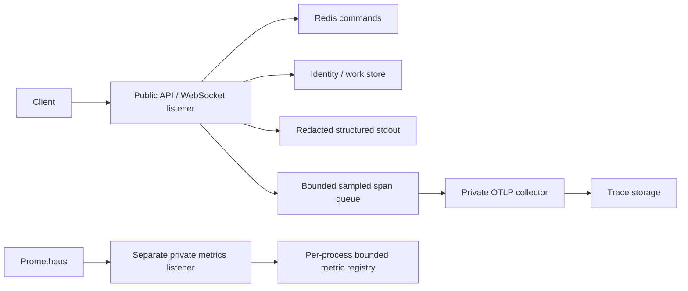

# Runtime observability: implementation and operating guide

Verified locally on 2026-10-18. This implements application logs, private pull
metrics and sampled OTLP traces for the current API, Redis and price stream. It
does not certify production operations, durable worker instrumentation, chain
indexing or provider execution. Decisions: D30–D32 in [DECISIONS.md](DECISIONS.md).

## Data path and trust boundaries



Metrics are not registered on the public router: public `/metrics` returns 404.
`METRICS_ADDR` is optional and disabled by default. Configuration rejects non-loopback
addresses, so deployments must use a local scraper sidecar or an authenticated local
proxy to scrape it. There is no metrics
bearer authentication or TLS terminator in the process. The separate listener
has a two-request scrape admission limit and returns OpenMetrics with no-store.

`HONEY_OTLP_TRACES_ENDPOINT` is an explicit complete `/v1/traces` URL. HTTPS is
required except on localhost; credentials, query strings, fragments and redirects
are rejected. No endpoint means no exporter. Generic OTEL environment variables
are not the deployment configuration contract. The exporter resource is built
explicitly from service name/version, without arbitrary environment resource data.

Each public HTTP request gets a server-generated request ID. When tracing is
configured, `x-trace-id` is also returned and exposed by CORS; the shared client's
`ApiError.traceId` preserves a validated ID. An ID can be valid even when its trace
was sampled out. Support must therefore start with the request ID/logs and treat a
missing trace as inconclusive. Inbound traceparent, tracestate, baggage and request
ID do not control the server's trace parent, sampling or correlation identity.

## What is recorded

| Surface | Implemented signal | Limits and interpretation |
| --- | --- | --- |
| HTTP | Count, duration histogram, active requests; root span and completion log | Server route template, normalized method and status class only; upgrades measure handshake duration, not connection lifetime |
| Redis | Command duration/outcome and child span | Outcomes: ok, busy, timeout, unavailable; no command arguments, channel, key or response body |
| PostgreSQL | Pool connections/idle and health; identity/work method child spans | Pool sampled every five seconds; no SQL text, row values, lock or acquire-wait histogram yet |
| Hyperliquid public prices | all_mids fetch duration/outcome and child span | Fixed provider/operation; no upstream body, account or dynamic asset labels; Earn readers now add Aave/Morpho HTTP outcomes and per-provider latency |
| Price sockets | Active gauge, frames, bounded close reason, and per-frame socket write duration; connection span/log | Write duration is a low-cardinality histogram and helps detect slow-client pressure; latest-value fanout has no per-user output queue; span ends at disconnect |
| Price freshness | Sample timestamp and stale gauge | Local mirror sample time, not exchange execution timestamp; wall-clock age needs synchronized clocks |
| Infrastructure | PG/Redis health, drain gauge, classified background failure counter | Liveness/readiness still have their own semantics; scrape health is not API health |
| Trace transport | Accepted/failed batch counts | Includes HTTP failures, malformed protobuf response and partial rejection; does not count exact spans lost in SDK queue |

The histogram buckets and label vocabularies live in `apps/server/src/metrics.rs`.
Labels never include IPs, wallet/user IDs, query/path input, tokens, transaction
hashes or error strings. Unknown paths use the fixed fallback route label; unknown
methods use `OTHER`. Future handlers must preserve this boundary. Metrics are per
process; restart resets counters. Aggregate rates across replicas, not raw counters.

Request cancellation releases active gauges through RAII. Completed-request counters
record responses produced by the HTTP envelope; disconnected/cancelled work may have
no response count. WebSocket frame counters count successful server sends, not client
render acknowledgements. Hyperliquid fetch failures currently share one class; do not infer quota consumption
or distinguish 429 from malformed data from that metric alone. Earn transport has
bounded error classes, but HTTP success is separate from domain validation.

Application spans use `skip_all` for identity/work/Redis methods. Only the
`honey_server` tracing target is exported/logged, even if RUST_LOG is verbose.
Dependency HTTP/SQL diagnostics are deliberately excluded because they can contain
credentials and payloads. Panic logs omit arbitrary payloads and retain file/line.
This reduces debugging detail; add reviewed classifications/events instead of
turning on unfiltered third-party logging in production. Logs are structured JSON
when `LOG_FORMAT=json`; production log shipping, access and retention are external.

## Bounds and failure behavior

- `TRACE_SAMPLE_PER_MILLE`: 0–1000, default 100 (10%). Head sampling, inherited by
  child spans, does not preserve all errors. There is no tail sampler in this stack.
- SDK queue: 2,048 spans; export batch: 256; scheduled flush: one second. Attribute
  limit: 24 per span; 16 events, 12 attributes per event, zero links. Current fields
  are bounded; these count limits do not replace careful string-length review.
- HTTP export: connect 500 ms, total request two seconds, one idle connection per
  host, response at most 64 KiB. No application retries; collector handles downstream
  retries. Requests enqueue spans without waiting on collector delivery.
- Export work runs on the live application Tokio runtime from the SDK batch thread.
  Runtime shutdown therefore follows export flush. Flush has a three-second SDK
  deadline and four-second outer wait; shutdown may lose spans. Traces are not an
  audit log and provide no delivery guarantee.
- Collector: 128 MiB memory limiter + 32 MiB spike allowance, batch 256/maximum512,
  two downstream consumers, queue 256 batches and bounded retry elapsed time15s.
  Containers have a 256 MiB hard limit each. Load or outages can drop telemetry.
- Required background task failure marks draining, closes service, cancels remaining
  tasks and exits unsuccessfully. An orchestrator must restart the process. A last
  failure metric can be missed before exit; retain classified logs/restart history.

An unavailable collector must not make readiness fail. An unavailable metrics
listener at startup fails startup; unexpected listener termination during service
is treated as a required task failure. These are different failure domains.

## Disposable local stack

Start Docker Desktop, then from the repository root:

```sh
docker compose -p honey-observability-local -f compose.observability.yaml up -d
METRICS_ADDR=127.0.0.1:29090 \
HONEY_OTLP_TRACES_ENDPOINT=http://127.0.0.1:24318/v1/traces \
TRACE_SAMPLE_PER_MILLE=1000 LOG_FORMAT=json \
cargo run -p honey-server
```

Use the database/Redis setup in [IMPLEMENTATION.md](IMPLEMENTATION.md) for durable
features. The above telemetry variables can be added to that server command.
Docker Desktop was verified to reach the host loopback metrics listener through
host.docker.internal. Linux needs a private host-gateway bind/firewall rule; do not
solve scrape routing by publishing metrics on the internet.

- Prometheus query UI: `http://127.0.0.1:29091`.
- Jaeger search UI: `http://127.0.0.1:26686`, service `honey-server`.
- Private metrics: `http://127.0.0.1:29090/metrics`.
- Collector intake: `http://127.0.0.1:24318/v1/traces`.

Jaeger stores traces in memory; Prometheus retains up to two hours/128 MB. No named
persistent volumes, host log mounts or external exports. Stop only the project you
started with `docker compose -p honey-observability-local -f compose.observability.yaml down`.
This is a local debugging stack, not a production storage or notification service.

Validate configuration and alert rules:

```sh
docker compose -p honey-observability-local -f compose.observability.yaml exec collector /otelcol validate --config=/etc/otelcol/config.yaml
docker compose -p honey-observability-local -f compose.observability.yaml exec prometheus promtool check config /etc/prometheus/prometheus.yml
docker compose -p honey-observability-local -f compose.observability.yaml exec prometheus promtool test rules /etc/prometheus/alerts.test.yaml
cargo test -p honey-server --test metrics --test observability
cargo test -p honey-server --test trace_export -- --ignored
```

The ignored trace test opens loopback sockets, decodes actual OTLP protobuf, verifies
request correlation and private-field omission, rejects remote parent injection,
then kills the collector and verifies HTTP requests still complete. It does not
require Docker. Prometheus/Jaeger acceptance was also performed against the actual
pinned containers: a request's returned trace ID resolved in Jaeger, a Redis child
span had the HTTP parent, Prometheus reported the target up, and logs/metrics/traces
excluded test bearer, channel, query and payload sentinels.

## Queries and incident actions

These are executable Prometheus queries, not pre-provisioned Grafana dashboards.
Use the local query UI or provision equivalent panels in the deployment's dashboard
system. Thresholds in `ops/observability/alerts.yaml` are candidates to calibrate;
no Alertmanager receiver or paging integration is configured here.

| Question | PromQL |
| --- | --- |
| Request rate by route | `sum by (route) (rate(honey_http_requests_total[5m]))` |
| Handler p95 by route | `histogram_quantile(0.95, sum by (le, route) (rate(honey_http_request_duration_seconds_bucket[5m])))` |
| Active sockets | `sum(honey_price_sockets_active)` |
| Price socket write p95 | `histogram_quantile(0.95, sum by (le) (rate(honey_price_socket_send_duration_seconds_bucket[5m])))` |
| Close reasons | `sum by (outcome) (rate(honey_price_socket_closes_total[5m]))` |
| Redis error outcomes | `sum by (outcome) (rate(honey_redis_commands_total{outcome!="ok"}[5m]))` |
| Price age in seconds | `time() - honey_price_sample_timestamp_milliseconds / 1000` |
| Trace export failures | `sum(rate(honey_trace_exports_total{outcome="failed"}[5m]))` |
| Due ready jobs | `honey_work_queue_jobs{state="ready"}` |
| Oldest ready age | `honey_work_queue_oldest_age_seconds{state="ready"}` |
| Expired leases | `honey_work_queue_jobs{state="expired_lease"}` |
| Dead jobs | `honey_work_queue_jobs{state="dead"}` |
| Oldest dead age | `honey_work_queue_oldest_age_seconds{state="dead"}` |
| Queue snapshot age | `time() - honey_work_queue_metrics_snapshot_timestamp_seconds` |
| Auth retention cleanup failures | `increase(honey_auth_cleanup_total{outcome="error"}[15m])` |
| Auth cleanup freshness | `time() - honey_auth_cleanup_success_timestamp_seconds` |

For API errors, inspect route/error class and request ID, then a sampled trace.
Compare Redis failures, pool occupancy and background drain before blaming provider
latency. For stale prices, inspect provider fetch outcomes, Redis health, poll
ownership and clock synchronization; never present stale data as executable quotes.
For missing traces, check sampling first, then export failures, collector/storage
limits and restarts. Never retry a financial action merely because its trace is absent.
For background exits, use the logged startup-defined task index/error class and
release version; restart history is authoritative when no last scrape exists.

Queue gauges refresh every 30 seconds from bounded indexed probes. State counts cap
at 10,001 (meaning at least 10,001); oldest age is for due ready jobs, expired leases,
or dead jobs. These are shared database values repeated by each replica, so do not
sum them across replicas. The unauthenticated scrape remains loopback-only; do not
create a public operator endpoint from these aggregates. They expose neither job IDs,
wallets, intents nor error codes. Retry behavior differs by worker, so a zero dead-job
gauge is not evidence that no work is retrying.

Authentication retention cleanup runs every 60 seconds with a 10-second deadline.
`honey_auth_cleanup_total` records each attempted pass with only `ok` or `error`
outcomes, and `honey_auth_cleanup_success_timestamp_seconds` advances on every
successful pass, including one that deletes zero rows. Alert on repeated errors
and success age exceeding three minutes; allow that startup grace before the first
scheduled pass. These metrics are per process, so group by `instance` when locating
an affected replica. They support retention operations and do not replace PostgreSQL
readiness or backlog monitoring.

Migration `202610190002_job_queue_metrics.sql` builds its dead-job partial index with
`CREATE INDEX CONCURRENTLY` and SQLx `no_tx=true`, so the queue can continue writing
while the index is built. Concurrent builds use additional I/O and may leave an
invalid index if interrupted. Before retrying a failed migration, inspect
`pg_index.indisvalid`; reconcile invalid-index state under an operator-reviewed
procedure rather than hiding it with `IF NOT EXISTS`. See the [operation-history
migration runbook](OPERATION-HISTORY.md#index-migration-and-operations) for the SQLx
nontransactional migration failure model.

Remaining production work: dashboard provisioning and alert routing; protected
collector transport/storage access; retention and cost policies; SDK-drop visibility;
per-worker identity and attempts/operation-state metrics; audited dead-letter
inspection/replay controls; provider quota metrics; chain lag/reorg and fee
reconciliation signals; full distributed context across durable jobs; staging
mixed-load and N-1 failure tests.

## Primary references

Versions were checked against package sources and official release/configuration
references on 2026-10-18: [OTLP0.33.1](https://docs.rs/opentelemetry-otlp/0.33.1/opentelemetry_otlp/),
[SDK0.33.1](https://docs.rs/opentelemetry_sdk/0.33.1/opentelemetry_sdk/),
[tracing-opentelemetry0.34.0](https://docs.rs/tracing-opentelemetry/0.34.0/tracing_opentelemetry/),
[Prometheus client0.25.1](https://docs.rs/prometheus-client/0.25.1/prometheus_client/),
[collector configuration](https://opentelemetry.io/docs/collector/configuration/),
[collector0.163.1](https://github.com/open-telemetry/opentelemetry-collector-releases/releases/tag/v0.163.1),
[Prometheus3.15.0](https://github.com/prometheus/prometheus/releases/tag/v3.15.0),
and [Jaeger2.22](https://www.jaegertracing.io/docs/2.22/getting-started/).
