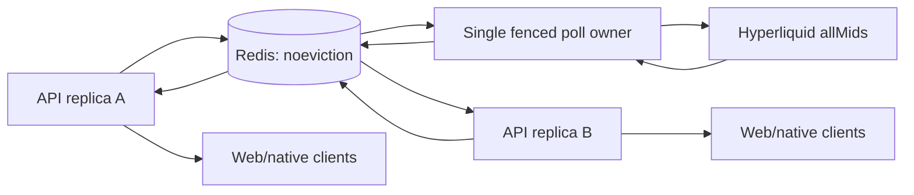

# Redis application state and public prices

Implementation record, 2026-10-18. This extends P0/P1 and decisions D24–D28.
It implements distributed pairing, shared public price ingestion, bounded cache
and WebSocket fanout. Provider trading, portfolio valuation, private order streams,
refresh sessions and production capacity certification are separate capabilities.

## Concrete topology



Each replica owns one lazily initialized multiplexed Redis connection manager.
An admission semaphore admits at most 128 outstanding application commands per
process. One deadline covers connection establishment and execution. Connection
and response errors log a constant classification, never command payloads or raw
Redis errors. Redis failure returns unavailable; it never selects local state.
The standalone router without infrastructure remains a development/test scaffold.
Production startup constructs Infrastructure and injects its shared stores.

Redis key namespaces are deployment-specific, validated, at most 48 ASCII
characters. Lua keys use explicit hash tags so all keys in one operation share a
Redis Cluster slot. The selected driver/configuration currently targets one Redis
endpoint, not a Cluster topology discovery client. Hash tags prepare the data
layout; they do not imply tested Redis Cluster support.

## Pairing contract

The HTTP token proof and existing cryptographic client handshake are unchanged.
With Redis configured, all replicas see the same mailboxes. The first write creates
a five-minute channel lifetime. All four slots expire together; a later slot does
not extend that window. A slot can be written once and read once. Reading replaces
its value with an empty tombstone until channel expiry; neither a read nor a replay
extends its TTL. A new write against a consumed slot conflicts.

A Lua operation atomically checks the slot and reserves shared capacity. Sorted
sets cap outstanding slots at 10,000 globally and 24 per IP subject, including
consumed slots until expiry. Expired reservations are lazily pruned using Redis
TIME. Commit, nonce and reveal messages are capped at 43, 22 and 64 bytes; only the
sealed payload slot may use up to 16 KiB. A shared byte counter caps aggregate
reserved payload strings at 32 MiB, independent of the slot-count cap. The byte
counter and per-reservation sizes are updated in the same Lua operation before the
payload hash write. Consumed slots retain their byte reservation through channel
expiry, so read-once tombstones do not reopen capacity early. These byte limits bound
payload data, not Redis key/hash/ZSET overhead; the 10,000-slot bound and Redis
`maxmemory`/`noeviction` policy still matter.

During rollout from the count-only script, existing reservations have no recorded
payload size. The first new send assigns each legacy reservation the maximum 16 KiB
size before evaluating the aggregate cap. This can temporarily deny new pairings
until legacy reservations expire, but cannot undercount unknown historical payloads.
The per-subject set expires; global reservations, byte metadata and counters are
pruned/expired on traffic. The IP is hashed before becoming a key; this is
pseudonymization, not anonymity.

Redis Lua provides isolation, not rollback after every runtime error. Capacity is
reserved before writing the payload. An out-of-memory error can leave a temporary
reservation and reject work, but cannot store an uncounted payload. This trades
availability for a strict memory/admission bound. No arbitrary channel history is
stored. `noeviction` is mandatory: eviction of tombstones would violate one-time
semantics inside the advertised lifetime. Redis loss/failover that loses writes
invalidates in-flight pairings; restart pairing. This store is deliberately not a
durable credential database. Production replication/persistence policy and failover
behavior still require deployment-specific testing.

## Price semantics: exactly what the values mean

`POST https://api.hyperliquid.xyz/info`, body `{"type":"allMids","dex":""}`.
Only BTC, ETH and SOL are accepted. No request-controlled URL, symbol or secret is
forwarded. Values stay positive decimal strings with at most 18 fractional digits
and 64 total characters. Missing symbols, numbers, exponents, zero, negative values
and malformed responses reject the entire sample. The response body is bounded to
256 KiB even without Content-Length; redirects are disabled; connect timeout is one
second and total request timeout two seconds.

These are venue perpetual mid prices; an empty book can return its last trade.
They are **USDT-denominated**, while those contracts use USDC collateral. No USD
conversion is assumed. They are not spot portfolio prices, oracle/mark prices,
liquidation inputs, executable quotes, guaranteed fills or fresh trade timestamps.

Sources checked 2026-10-18:

- [Hyperliquid info endpoint](https://hyperliquid.gitbook.io/hyperliquid-docs/for-developers/api/info-endpoint): allMids schema and fallback semantics.
- [Contract specifications](https://hyperliquid.gitbook.io/hyperliquid-docs/trading/contract-specifications): USDT denomination versus USDC margining.
- [Rate limits](https://hyperliquid.gitbook.io/hyperliquid-docs/for-developers/api/rate-limits-and-user-limits): allMids weight 2 and aggregate 1,200 weight/minute/IP.

A shared Redis poll lease reserves at most one request per second across replicas:
120 weight/minute, before other consumers on the egress IP. This is a budget for
this collector, not a promise of spare capacity for trading/private data. The poll
owner holds a ten-second renewable lease. Publishing checks both owner and expiry;
an old process cannot overwrite a new owner's cache. Provider errors install shared
backoff, honoring bounded Retry-After, with classified logs. Redis outage halts polls.
A new owner can take over after expiry. Failover can skip samples; it cannot promise
uninterrupted one-Hz freshness.

The poll script returns the remaining wait in milliseconds when the shared poll
budget or another owner's lease prevents a request. The collector sleeps for that
Redis-derived delay and asks again, instead of combining Redis's global deadline
with a local one-second timer. This avoids phase-alignment misses where a local tick
arrives just before the shared deadline and wastes nearly another second. The first
20-second diagnostic after this change delivered 19 frames/client; it was an early
cadence check and was superseded by the strict 60-second acceptance run below.

Each accepted publication increments a decimal sequence string inside an epoch.
Sequence is stored with HINCRBY and read back as a string, avoiding Lua double
rounding of the sequence value. Epoch persists across collector handoff and changes
when the control state is recreated. Snapshot TTL is 60 seconds. Per-replica mirror
polling is every 500ms, independent of client count. Redis pub/sub was deliberately
not required for correctness: a disconnected subscriber cannot lose a necessary
delta because every value is a full snapshot.

## API and frontend contract

- `GET /api/v1/prices`: latest full snapshot; 422 if not configured, 503 while empty.
- `GET /api/v1/stream/prices`: actual WebSocket upgrade, same full snapshot schema.
- `GET /api/v1/capabilities`: `price_stream` is available only while a local sample is fresh. The runtime contract is schema v3: separate quote/catalog/account-read features may be available in read-only scope when configured, while execution features remain unavailable or local-testnet-only. See [IMPLEMENTATION.md](IMPLEMENTATION.md) and D101 in [DECISIONS.md](DECISIONS.md).

```json
{
  "schemaVersion": 1,
  "type": "snapshot",
  "epoch": "01234567-89ab-4cde-8fab-0123456789ab",
  "sequence": "42",
  "sampledAtMs": 1792300000000,
  "stale": false,
  "source": "hyperliquid",
  "prices": [
    {"instrumentId":"hyperliquid:perp:BTC","symbol":"BTC","quoteUnit":"USDT","price":"60000.123456789","kind":"mid_or_last"},
    {"instrumentId":"hyperliquid:perp:ETH","symbol":"ETH","quoteUnit":"USDT","price":"3000","kind":"mid_or_last"},
    {"instrumentId":"hyperliquid:perp:SOL","symbol":"SOL","quoteUnit":"USDT","price":"150","kind":"mid_or_last"}
  ]
}
```

`sampledAtMs` is Redis time when the validated upstream response is published, not
exchange event time or collection-start time. This conservatively includes provider
request latency in the freshness age. More than five seconds old, or future-dated
relative to the checking clock, is stale.
A cached value can remain visible indefinitely with `stale=true`; it never silently
turns into a fresh zero or fabricated price. Redis/application/client clocks need
NTP and skew alerts. In-process mirror failure still permits HTTP freshness checks;
the client also marks silence stale independently.

The shared API client validates source, fixed symbols/IDs, unit, decimal grammar,
UUID epoch, safe timestamp and u64 sequence. Frames over 8KiB or malformed frames
close the stream. Lower sequences in the same epoch are ignored. Reconnect starts
with a new full snapshot; sequence gaps are normal. Reconnect uses exponential
jitter, 0.5–30 seconds, and a ten-second first-snapshot deadline. Explicit cleanup
cancels timers and reconnects. Tokens are never placed in the public stream URL.
The web shell mounts a live-price component only when the server reports the feed
configured, and displays stale/reconnecting states. Native non-demo Perps list/detail screens consume the same contract, with focus
and AppState cleanup. They display no demo history/positions or order controls;
demo wallets retain the existing demo screens. Physical native-runtime acceptance
is still required.

## Bounded fanout and abuse controls

One serialized reference-counted frame is shared per replica. Each socket watches
a single latest value; slow readers skip older frames. No per-user unbounded event
queue or per-user provider request exists. Socket read buffers are 4KiB; inbound
message/frame limit is 4KiB; maximum write buffer is 16KiB. Each send has a two-second
deadline. Native/WebSocket ping runs every 15 seconds; no inbound heartbeat for 45
seconds closes the connection. Client commands/binary data are rejected; the feed
has no subscription language. More than 32 inbound messages per heartbeat period
closes the connection.

`honey_price_socket_send_duration_seconds` observes the wall time spent writing each
full snapshot, including a write that reaches the two-second timeout. It is a
per-process aggregate with no connection or user labels. Watch its p95/p99 alongside
send-deadline closes and active sockets when tuning the connection cap; the counter
of frames is a successful server-side write, not proof that a client rendered it.

A local semaphore and Redis leases enforce the global and per-subject connection
caps. Leases last 60 seconds and renew every 20 seconds; failed renewal closes the
socket. Explicit disconnect releases the lease; crashes temporarily consume
capacity until TTL. IPv6 subjects are /64s. The default per-IP limit of 64 can
reject legitimate large NATs: tune from measured deployment data, with authenticated
quotas/edge admission for broader access. All replicas must use identical caps.

Browser Origin must exactly match the configured CORS allowlist. Multiple Origin
headers fail. Originless native clients may connect because this data is public.
There is no user authentication or per-user subscription authorization on this
public display feed; Origin is a browser cross-site control and must not be treated
as identity. Forwarded-header trust also checks the socket peer
against configured `TRUSTED_PROXY_CIDRS`; direct clients cannot choose an arbitrary
quota identity. Keep the CIDRs aligned with the actual proxy network and sanitize or
append the client address there. Draining closes active sockets and rejects new ones.

## Local verification and capacity experiment

Start only the disposable compose project, then:

```sh
TEST_REDIS_URL=redis://127.0.0.1:26379 cargo test --locked \
  --test redis_application --test price_stream -- --ignored
cargo build --locked -p honey-server --example price_load --release
TEST_REDIS_URL=redis://127.0.0.1:26379 LOAD_USERS=10000 LOAD_SECONDS=60 \
  /usr/bin/time -l target/release/examples/price_load
```

The five integration tests cover two independent Redis connections, racing one-time
writes/reads, tombstones, shared expiry/quotas, unavailable Redis, fenced publication,
shared refresh budget, actual TCP upgrades, Origin, per-IP rejection, frame contents,
sequence regression, stale HTTP snapshot and drain. They use unique random Redis
namespaces, never FLUSHDB. CI runs them explicitly; ordinary test runs skip network
requirements. Client tests cover decimal validation, stale silence, ordering,
reconnection, malformed input and cleanup.

The experiment uses the production router and actual TCP WebSockets, one synthetic
snapshot/second, shared Redis admission/renewals, and sequential HTTP reads targeting
100/second during soak. It ramps 50 connections per 100ms. Same-process clients read
frames and answer ping. It reports connection counts, unexpected disconnects, HTTP
latencies/errors, frame-lag histogram and elapsed time. Assertions require all target
connections alive, no unexpected disconnects/HTTP errors, and sufficient received
frames. This is a bounded local experiment, not independent load-generation,
production TLS, account traffic, provider latency, N-1, long soak or restore evidence.
Measured results are recorded separately; do not equate configuration with evidence.

The explicit `market_smoke` example passed a real read-only Hyperliquid fetch through
the collector, Redis publication and local mirror on 2026-10-18. The reproducible
local 10k experiment and raw results are in [CAPACITY-LOCAL.md](CAPACITY-LOCAL.md).

For an independently generated connection load against a separately running API
replica, use [`price_load_client`](../../apps/server/examples/price_load_client.rs).
It opens up to 10,000 real WebSockets at a configured ramp rate, validates every
text frame as a `PriceSnapshot`, and schedules HTTP snapshot requests open-loop
instead of waiting for each response before scheduling the next. It exits nonzero
if any socket fails to establish or disconnects, HTTP errors exceed the configured
threshold, requests remain in flight at the soak deadline, or total frames fall
below the per-client floor. It emits a JSON report suitable for archiving. It can
sample one `ps` row for the API PID; this is a point-in-time process observation,
not a peak, cgroup/container, or host-resource measurement. Latency percentiles use
the first 100,000 completed requests, and the client reports in-flight requests at
the soak deadline separately from requests drained afterward.

Build the independent generator with `cargo build --locked --release -p
honey-server --example price_load_client`, then run it from another process after
starting the API with Redis and fresh prices configured. This local build accepts
`ws://` only and therefore does not include TLS termination overhead:

For a public-read smoke, a single process may still run both loads as below. To
claim the combined authenticated profile + socket gate, use the shared-epoch,
five-shard protocol in [CAPACITY-LOCAL.md](CAPACITY-LOCAL.md#coordinated-split-generators);
the example here is not that acceptance run:

```sh
LOAD_WS_URL=ws://127.0.0.1:8080/api/v1/stream/prices \
LOAD_HTTP_URL=http://127.0.0.1:8080/api/v1/prices \
LOAD_SERVER_PID=<api-pid> LOAD_USERS=10000 LOAD_RAMP_MS=30000 \
LOAD_SECONDS=60 LOAD_HTTP_RPS=100 LOAD_MAX_HTTP_ERRORS=0 \
LOAD_MIN_FRAMES_PER_CLIENT=45 \
target/release/examples/price_load_client > capacity-run.json
```

This is an opt-in, read-only public endpoint workload; do not point it at a
production service without a separately approved capacity window. It does not
authenticate users, exercise account/quote/transaction routes, or replace independent
generators, TLS/proxy and multi-replica failure tests. Two local separate-process
runs connected 10,000 sockets and met the 100-RPS/HTTP-error thresholds, but both
received only 42 frames per client during a 60-second soak and failed the 45-frame
floor. Redis-deadline scheduling fixed the local cadence; the later strict run passed
the higher 60-frame floor and exact request-count gate. Details and raw outputs are in
[CAPACITY-LOCAL.md](CAPACITY-LOCAL.md).
This is a local single-replica price-stream result, not proof of 10k authenticated
or financial users in production. The earlier 10k result above remains same-process
and synthetic-ingress.

## Price Redis failure visibility (2026-10-19)

The server exports `honey_price_redis_operations_total` with fixed `operation`
(`poll`, `publish`, `read`) and `outcome` (`ok`, `empty`, `unavailable`,
`fenced`, `invalid`) labels. This distinguishes a healthy upstream fetch from Redis
lease/mirror propagation failures while retaining the local latest-snapshot fallback.
Lease acquisition and snapshot publication failures emit structured warnings with
bounded operation/error codes; periodic mirror reads use counters rather than a
warning per 500 ms poll, avoiding log floods during a sustained Redis outage.
The metrics label contract and the real Redis cross-hub publish/fencing/socket tests
pass. This is diagnostic instrumentation, not Redis failover or multi-region proof.
