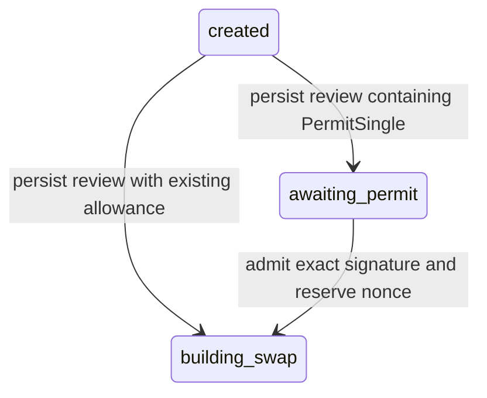

# Uniswap review and permit persistence

Status: internal repository implemented; **no HTTP signing endpoint or executing
swap worker is enabled**. Migration 9, `src/swap_review.rs`, and
`tests/swap_reviews.rs` provide the durable step before the encrypted built-swap
preparations described in [SEALED-SWAP-PREPARATIONS.md](SEALED-SWAP-PREPARATIONS.md).
Design decisions: D73–D74 in [DECISIONS.md](DECISIONS.md).

## State and transaction boundaries

These transitions install immutable evidence and complete/enqueue PostgreSQL jobs
in the same transaction. A created-job lease fences review installation. The
operation row serializes signature admission; the nonce guard serializes competing
operations even across worker processes. No PostgreSQL connection is held across
provider or RPC requests by these repository methods.

`awaiting_permit` has no build job. Once the signature is accepted, exactly one
`operation.changed` job is enqueued. The no-permit branch queues a build directly.
The caller must first establish sufficient existing Permit2 allowance for that
branch. This repository does not infer allowance from the absence of a signature.

The shared client recognizes both states only for swap operations. Neither permits
transaction/preparation evidence in the client recovery validator. Native activity
shows “Awaiting token permission” or “Preparing swap”; it does not expose a signing
button from these states. Existing owner history/recovery stays free of signatures,
raw provider responses and calldata. A signature does not mean a submitted or
successful swap.

## Public review and encrypted provider response

The review fixes schema version, operation intent hash, quote ID and canonical quote
hash, registry/fee revisions, exact spending/receive/deadline/recipient authority,
Permit2 contract and optional PermitSingle terms, maximum network fee, observation
and review timestamps, and expiry. Integers describing amounts/chains/nonces remain
canonical decimal strings. Timestamps are bounded JavaScript-safe milliseconds.

Creation requires a quote observed within 30 seconds and an unexpired review with
at most 15 minutes remaining. Router deadline equals review expiry at a whole-second
boundary. A permit must bind the same chain, owner, contract, token, amount and
router; its signature deadline must cover the router deadline. Existing Permit2
policy imposes finite uint160 spending, low-S EOA signatures, uint48 nonce and
bounded signature/allowance lifetimes. No replacement quote, wider minimum, revised
fee authority, or renewed expiry can update an installed review. A later attempt
needs a new operation and review.

`persist_swap_review` verifies basic raw quote identity and its hash. It does **not**
replace the provider normalizer or bind every product-specific intent field. The
trusted adapter must establish the route, token registry, fee policy, quote-to-intent
relationship, existing allowance, contract identity and chain observations first.
These are explicitly unfinished service responsibilities; a public caller cannot
invoke this repository through the current API.

The public canonical review is limited to 32 KiB. The canonical raw quote object is
limited to 256 KiB and encrypted using existing application data-encryption keys,
a random XChaCha20 nonce, and domain `honey.uniswap.review-quote.v1`. Associated data
binds operation, user, wallet, immutable intent, review/quote hashes and key ID.
`load_swap_review` authenticates the encrypted quote even when returning only public
terms. Merely editing a plaintext review and recomputing its checksum cannot change
what a wallet should be asked to sign.

## Signature admission, retries and nonce scope

`stage_swap_permit` takes authenticated principal/wallet/operation identity, expected
operation version, exact review hash, a signature, and trusted RPC nonce evidence.
It verifies EIP-712 EOA ownership of the persisted PermitSingle terms. The raw 64- or
65-byte signature is encrypted under a separate `honey.uniswap.permit.v1` domain.
Associated data also binds the admitted version, permit digest and signature hash.
There is no plaintext signature column. Ciphertexts and review/signature rows are
immutable; application keys must remain available after rotation.

An exact retry returns current operation metadata without creating another job or
reservation, including after the review has expired. It authenticates the original
ciphertext and compares the exact signature bytes and original admitted version.
A different signature encoding conflicts even if it represents equivalent authority.
This deliberately avoids silent replacement and multiple accepted payloads.

The database reservation key is `(chain, Permit2, owner, token, spender, nonce)`.
This follows Permit2's nonce scope, independently of Ethereum transaction nonces.
Two admitted operations cannot compete for this same authority while its signature
is valid. Different token/spender scopes do not unnecessarily serialize one wallet.
The nonce observation must match every scope field and be at most 10 seconds old;
expiry and observation age are checked again at the final state write after locks.
Any failed signature, guard reservation, state update or outbox insert rolls back
all changes in that transaction.

A reservation outlives a failed build. Permit2's signature deadline is inclusive:
its source rejects only when `block.timestamp > sigDeadline`. Therefore reservation
reuse requires both server time and a verified **finalized chain timestamp** to
reach `sigDeadline + 1`, plus a fresh matching nonce observation. Server clock alone
cannot establish that an old authorization has become unusable on-chain. Finality
lag intentionally delays retries for unused permits. The observation type is an
internal Rust type, not a deserializable client payload. The internal RPC producer in [UNISWAP-PREPARATION.md](UNISWAP-PREPARATION.md)
checks chain identity and the finalized watermark and still needs service integration; a caller-supplied timestamp
would invalidate this protection. External wallet activity and reorgs still require
fresh chain/nonce checks before preparation and dispatch.

Official semantics:
[AllowanceTransfer nonce scope](https://developers.uniswap.org/docs/protocols/permit2/concepts/allowance-transfer),
[Permit2 pinned source](https://github.com/Uniswap/permit2/blob/cc56ad0f3439c502c246fc5cfcc3db92bb8b7219/src/AllowanceTransfer.sol).

## Recovery, failure and remaining integration

`load_swap_build` authenticates the exact review, raw quote and optional signature
for an unexpired `building_swap` operation. Its sensitive result has neither Debug
nor Serialize; owned plaintext/decryption/signature buffers use zeroizing wrappers.
This is best-effort memory hygiene: caller-owned JSON/string buffers and third-party
parser/runtime copies are not guaranteed wiped. Instrumented repository spans skip
arguments, so signature/provider contents do not enter tracing fields.

This read is not a worker lease or permission to contact a provider. The future
service must claim its dedicated job and recheck authority before and after I/O.
The existing created-to-prepared sealed repository remains a separate internal
primitive; it does **not** yet advance `building_swap` to `awaiting_signature`.
No background worker consumes these new build jobs through a public swap flow yet.

Required next integration:

1. Use the validated provider quote artifact now implemented in
   [UNISWAP-BUILDS.md](UNISWAP-BUILDS.md) and create a review only after fresh
   chain/allowance/identity/nonce observations and explicit user intent binding.
2. Integrate the implemented build transport and calldata/permit/economic checks
   with code identities, fresh allowances/nonces, local fee estimation and sequence
   simulation. Authenticated provider acceptance remains unverified.
3. Wire the worker to the implemented reviewed build/preparation handoff (D79,
   [details](UNISWAP-PREPARATION.md#reviewed-durable-handoff)). Expired/failed builds need explicit terminal/review
   recovery behavior; never silently release a still-valid permit or re-quote it.
4. Expose authenticated, rate-limited HTTP review/permit/build recovery and implement
   independent native review/signing checks with foreground/session/account fences.
5. Obtain provider acceptance evidence using configured credentials, exercise the
   full durable path on a disposable fork, then assess production prerequisites.

## Migration and validation

Migration 9 adds immutable review/signature evidence and reusable scoped nonce
guards and widens the operation-state check. Authenticated readiness requires it.
Drain old server and client versions before writing the new states. No existing
Earn data is rewritten. Only per-test disposable databases were migrated; shared
or production schema rollout remains an explicit operational action.

`cargo test --locked --test swap_reviews -- --include-ignored` with
`TEST_DATABASE_URL` pointing at an isolated PostgreSQL service creates/drops one
database per test. Coverage includes review/permit binding, concurrent admission,
exact retry, encryption/restart/key rotation, owner isolation, scoped nonce conflicts,
outbox rollback, stale scope/version/time/signature rejection, no-permit recovery,
immutable row guards, ciphertext substitution, metadata rehashing, inclusive expiry,
chain-finality-gated reuse and freshness after a lock wait. Chain evidence in these
tests is synthetic. They prove database behavior, not live provider acceptance,
production throughput, or a completed swap execution service.
