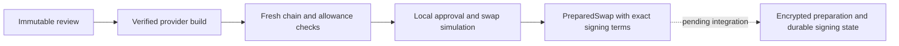

# Uniswap chain observations and local preparation

Status: internal Ethereum CLASSIC observation/preparation code is implemented in
`apps/server/src/providers/uniswap_execution.rs`. Tests use local RPC mocks.
**This new preparation path has not yet passed an actual-contract fork test and is
not exposed through a swap signing API or worker.** The earlier seven-route router
acceptance is separate evidence; it does not prove this RPC/preparation integration.
Decisions: D77–D78 in [DECISIONS.md](DECISIONS.md).

## Registry and chain scope

The internal policy requires chain ID, router and Permit2 bytecode pins, V2/V3
factory, V4 PoolManager and wrapped-native dependency pins, the complete reviewed
token vocabulary, registry/fee revisions, per-transaction gas limit and a bounded
quote-block lag. Only Ethereum and an explicit loopback chain-31337 fork are accepted.
Other chains remain quote-only until their contracts and execution behavior are
separately verified. No production policy loader or capability activation is added.

Every token declares direct code, an EIP-1967 implementation, or the reviewed USDC
implementation-slot family. Both outer and implementation code hashes are checked
for supported proxies. Decimal values must match the policy. Arbitrary client
storage slots and automatic proxy-family inference are not accepted. These choices
are operator-reviewed registry data; a matching on-chain hash alone is not approval
of a token or protocol.

The registry must establish that dependency addresses match the pinned router's
constructor/immutable parameters. This module does not extract immutable constructor
values from bytecode. It assumes approved standard, non-rebasing, non-tax tokens and
reviewed dependency closure; unknown proxy families, nested upgrade paths and mutable
token behavior require additional registry work. Code pins cannot prevent an upgrade
between observation and inclusion. Fresh pre-dispatch checks remain mandatory.

## Observation and permit admission

`observe` binds its private result to the immutable review hash. The sequence is:

1. Check chain identity, current head, finalized block and the provider quote's source
   block. The quote cannot be from the future or exceed the configured lag (1–128
   blocks). Production head timestamps must be within 120 seconds of local time and
   no more than 15 seconds ahead. Finalized height/time cannot exceed the head, and
   finalized time cannot be ahead of local time. Historical source state is permitted
   only for the explicit local fork.
2. Read signer code at that head and require an ordinary EOA. Contract accounts and
   EIP-7702-delegated accounts are rejected. Check all required code/implementation
   pins and decimals at the same block number.
3. Read chain and pending Ethereum nonces, Permit2's packed allowance, input-token
   balance, ERC20 allowance to Permit2 and native gas balance. Pending Ethereum nonce
   must equal the pinned nonce. Strict ABI decoding requires exactly three words
   with uint160 amount and uint48 expiration/nonce for Permit2.
4. For a new PermitSingle, require its reviewed nonce to equal the observed nonce and
   reject the exhausted uint48 increment boundary. Without a permit, existing amount
   must cover the input and existing expiration must cover the router deadline.
5. Re-read source/finalized block hashes and numbers to detect a canonical-chain
   change. Recheck production source freshness and review expiry. The nonce sample
   itself must still be within 10 seconds when exported for admission.

`SwapChainObservation::permit_observation` produces the scoped evidence consumed by
[permit staging](SWAP-PERMIT-LIFECYCLE.md). No RPC observation can be deserialized from
an HTTP body. The finalized watermark allows the database reservation rule to wait
until an old signature is actually expired on a finalized chain, rather than using
server time alone. External permits and mempool transactions remain a race requiring
fresh allowance/nonce checks before signing preparation and dispatch.

The observation method's quote-block argument is trusted service input from the
validated artifact, never a client assertion. Preparation takes that block directly
from the private `VerifiedSwapBuild` provenance, which now retains it from the exact
provider quote. No new public response fields are exposed.

## Finite approvals and complete simulation

If ERC20 allowance to Permit2 is below the approved input, preparation adds an exact
approval. A nonzero insufficient allowance is reset to zero first. Sufficient
existing allowance is left in place. This flow never creates an unlimited ERC20 or
Permit2 approval, although a sufficient previously granted unlimited allowance may
already exist.

All approvals and the exact verified router call are simulated together through
`eth_simulateV1` at the pinned source block. There are no balance/storage overrides.
Balance queries before and after the action measure owner input/output, fee-recipient
output and every approved router-token balance. The simulation also reads the final
Permit2 allowance/expiration/nonce. The response must contain one block, the expected
parent hash, a timestamp after the source block and before the review deadline, and
exactly the expected ordered call results.

Checks include:

- Successful status with no error for every read and action; approval return data
  must be true, with empty return accepted only under an explicit per-token registry
  opt-in for reviewed legacy behavior.
- Owner input starts at the observed balance and cannot increase or decrease by more
  than the approved input. Owner output gain must meet the immutable minimum.
- Fee balances cannot decrease. Each actual fee must fit its reviewed percentage of
  measured gross output plus the explicit base-unit rounding allowance; arithmetic
  uses full-width integers and division before multiplication to avoid overflow.
- Router balances cannot increase for any approved token. Existing dust may be
  returned to the owner; this does not authorize retaining newly acquired funds.
- Permit2's final nonce and expiration must match the expected permit/no-permit path.
  Remaining allowance cannot increase or consume more than the input. Existing
  uint160-max authority is treated according to Permit2's non-decrementing behavior.
  The static calldata verifier remains the independent spending/recipient proof.

Simulation uses `validation: false`, consistent with the existing Earn preparers.
It is a state-transition experiment, not mempool admission or a signature check.
Ethereum nonce, EOA identity, native balance, gas bounds and fees are checked
separately. See [Ethereum simulation notes](https://ethereum.github.io/execution-apis/docs/ethsimulatev1-notes/)
and [Geth RPC documentation](https://geth.ethereum.org/docs/interacting-with-geth/rpc/ns-eth).
Permit2 nonce/allowance semantics are described in
[Uniswap's AllowanceTransfer reference](https://developers.uniswap.org/docs/protocols/permit2/concepts/allowance-transfer)
and the pinned source recorded in [UNISWAP-AUTHORITY.md](UNISWAP-AUTHORITY.md).

## Signing terms and lifetime

Per-step gas limits use measured gas plus a 20% margin and 10,000 units, bounded by
the configured maximum (21,000–2,000,000). Maximum fee per gas is twice the source
base fee plus the observed priority fee. The total ceiling must fit both the user's
reviewed network budget and observed native balance. The source/finalized hashes,
pending nonce and expiry are checked again after simulation. This is estimation;
future base fees, state changes or inclusion delay can still cause failure.

`PreparedSwap` has private fields and no Debug/Serialize. It retains the review hash,
provider build request ID and a `PreparedEvm` with exact nonce/gas/fee terms, ordered
calls and source-block simulation evidence. Its expiry is the original review expiry;
preparation never renews it or reduces the minimum receipt.

Plan fee amounts are **point-in-time simulated amounts**, not fixed execution fee
caps. The immutable review's percentage/rounding authority must accompany the future
wallet review and be independently validated there. Showing only simulated numeric
fees as guaranteed final fees would be incorrect. No native signing flow consumes
this new result yet.

## Limits, cost and validation

Observation has a 60-second overall deadline; full preparation is bounded by the
lesser of 60 seconds or remaining review life. Existing shared RPC admission and
simulation cost charging apply. The finite registry is capped at 64 tokens, and all
of them are checked rather than trusting route metadata to omit dependencies. The
tradeoff is substantial RPC cost: token/proxy reads and before/after balance checks
scale with registry size. This needs measurement in the mixed-load capacity profile;
these mock tests establish neither throughput nor affordable provider quotas.

Five new tests cover strict packed-allowance ABI bounds; reset/exact/sufficient
approval paths and legacy empty returns; contract/proxy/chain/decimal/nonce/finality/
reorg failures; net balance, residual, Permit2, fee, gas and late pending-nonce
failures; and existing-permit/no-permit fee paths. All use synthetic local RPC
responses and public fixture identities. Required next evidence is actual-contract
fork preparation, including first-use approvals and partial/refund paths.

## Reviewed durable handoff

`WorkStore::persist_reviewed_swap_preparation` accepts the private `PreparedSwap`
produced by the preparer. It fences the current job token/version and locks the
operation before authenticating its original review, encrypted quote and admitted
signature. Only `building_swap` can advance through this entry point. The existing
legacy storage entry point remains restricted to `created` and cannot accept an
operation that has review evidence.

A version-2 encrypted envelope contains the full preparation, review hash and
provider build request ID. The request hash and existing AEAD associated data bind
all of these to the operation, owner, wallet and public summary. No new SQL schema,
plaintext metadata row or public recovery response is needed. The public plan hash
continues to identify the plan; it is not a substitute for authenticating the full
envelope and review. The immutable review's quote hash transitively identifies the
exact provider quote. The provider request ID is diagnostic provenance, not proof
of provider acceptance or execution.

Both persistence and keyed recovery check the exact reviewed signer, chain, intent,
quote, expiry, registry, fee policy, spend, minimum receive and network budget. They
also revalidate router economics, the exact admitted embedded signature and the
only supported approval sequences: none, exact approval, or reset plus exact
approval. Simulated fee recipients/assets must match the reviewed fee policy;
amounts remain point-in-time estimates. Historical validation uses the original
review time and never renews signing or submission authority.

Insertion, state/version advance, completion of the leased job and creation of one
successor job commit together. The final write rechecks lease, review expiry and
simulation freshness, including after insert-trigger or lock waits. No RPC/provider
request runs inside the database transaction. A losing or stale worker rolls back;
it cannot replace the immutable preparation. A worker recovering from an ambiguous
commit must inspect operation state instead of rebuilding or renewing the review.

`load_reviewed_swap_preparation` returns authenticated review, preparation and build
request ID together for the future signing service. The generic submission and
reconciliation loader also verifies the review linkage. A reviewed envelope without
its review, or a legacy envelope attached to an operation with a review, fails closed.
Public recovery still contains no calldata or permit signature. Removing an old
DEK prevents opening every record encrypted under that key, so rotation must retain
keys needed by review, permit and preparation history.

**Tradeoffs:** the authenticated envelope avoids another metadata table/migration
and protects provenance from independent edits. It adds review/quote/signature reads
and cryptographic validation to keyed recovery. Old binaries cannot read the new
envelope: drain/upgrade API and worker readers before enabling a writer. Legacy
unreviewed encrypted records remain readable only without review rows. This is a
format compatibility rule, not approval to expose legacy signing publicly.

Five opt-in tests combine the existing mock-RPC preparer with isolated PostgreSQL:
concurrent writers/restart/key rotation and owner/key isolation; no-permit preparation;
changed terms/stale lease rejection; successor-job failure rollback; and lease
expiry during insertion. Corrupted review ciphertext is rejected by keyed recovery.
Existing preparation/submission/durability regressions cover legacy compatibility.
These tests prove the durable boundary, not a live provider or actual-contract flow.

Actual-contract V3 preparation and the durable HTTP/worker lifecycle now pass
[service acceptance](UNISWAP-SERVICE-ACCEPTANCE.md), including pre-dispatch revalidation,
restart recovery, fees, a lost acknowledgement and an unfillable minimum. Additional
route/fault scenarios, authenticated provider acceptance, production registry approval,
device UX and mixed-load/failover evidence remain required. Production execution is disabled.
